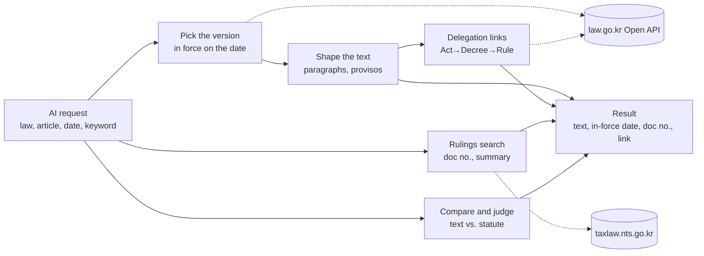

# korean-tax-mcp — Korea Tax Law MCP

<!-- mcp-name: io.github.UpstageAI/korean-tax-mcp -->


[](https://www.upstage.ai/)

> **Code has been written by Solar Pro 4 since 0.7.0**, reviewed by CodeSolar and cross-checked with tests by Claude. 22 tools — see [CHANGELOG](CHANGELOG.md).

An MCP server for **Korean tax law sources**. Plug it into Claude, Cursor, or any MCP client to get National Tax Service (NTS) rulings, court and tax tribunal decisions, basic rules, and statutes — with document numbers.

## How it works



1. **Statutes** (`law_article`, `find_article`, `article_history`) — fetches the list of versions of the law from the law.go.kr Open API and picks the one in force on the base date (today if no date is given). It splits the article into paragraphs and items, returns only what was asked, and lists proviso sentences ("다만", "제외", "불구하고") separately. Act → Decree → Rule links come from the official three-tier comparison table and quoted phrases in the lower-level text.
2. **Rulings and rules** (`search_tax_rulings` and 5 more) — searches the NTS tax law information system for rulings, court and tribunal decisions, basic rules and execution standards, and returns document numbers, summaries and links. Results are cached on your PC for one day.
3. **Base-year bundle** (`research_issue`) — sets the base date by tax type (corporate/income: end of the fiscal year, VAT: end of the tax period, transfer: transfer date, inheritance: date of death, gift: gift date, withholding: payment date), then gathers that day's statute (three tiers), rules and rulings and flags changes against the current text.
4. **Compare and judge** (`verify_statement`, `judge_options`, `compare_outcomes`, `compare_with_case`) — compares statements with the statute text of that version word by word and marks differing numbers, modality, opposite terms and provisos. Tribunal and court decisions are sorted into taxpayer wins and losses from the disposition text.
5. **Treaties, residency, documents** — treaty articles and withholding rates for 96 countries, residency determination by the three-stage Income Tax Act rules, and search over forms, NTS publications and PDFs on your PC.

Lookups, comparisons and determinations run on code rules. Upstage Solar is used only when configured, for outcome summaries, fact comparison, the residency report and English translation. Results are source material; interpretation and conclusions are left to your AI and a professional.

Works well alongside [korean-law-mcp](https://github.com/chrisryugj/korean-law-mcp) for general Korean statutes.

## Features

| Tool | What it does | Key |
|---|---|---|
| `search_tax_rulings` | Search NTS rulings (Q&A replies, advance rulings) and decisions (courts, Tax Tribunal, objections) — most relevant first (sort="최신순" for newest first), filter by tax type and date | none |
| `get_tax_ruling` | Full text — facts, question, reply / holding and reasons, cited statutes | none |
| `rulings_by_article` | All rulings and decisions citing a given article (e.g. Corporate Tax Act Art. 52) | none |
| `basic_rules` | Full text of NTS Basic Rules (기본통칙) by article | none |
| `execution_standards` | Tax Execution Standards (집행기준) items, page and link | none |
| `casebook_search` | NTS 2025 Tax Interpretation Casebook (96 cases) | none |
| `find_article` | **Find statute articles by keyword** — first step when you don't know the article number. Searches article titles and bodies across major tax laws (National Tax Basic Act, Collection Act, Income Tax Act, Corporation Tax Act, VAT Act, Inheritance/Gift Tax Act, Special Tax Treatment Control Act, International Tax Adjustment Act + their enforcement decrees), returns top n by keyword score. Result: [{law, article, title, effective_date, matching_sentences}], next step: `law_article` for the specific article. | `LAW_OC` |
| `verify_statement` | **Compare a claim against statute text** — checks a statement against the article's units in the edition in force and returns number / modality (may–shall–shall not) / antonym / timing differences plus changed or swapped phrases and provisos the claim ignores, with a verdict (contradiction / phrase differs / no difference / needs judgment). Every quoted phrase is a substring of the statute; rules only, no LLM. | `LAW_OC` |
| `judge_options` | **Judge several options at once** — takes multiple statements (a single string with ①~⑤ is split) and up to 5 article numbers, picks the best-overlapping article per statement and returns contradiction / phrase differs / no difference / needs judgment with a summary. Missing articles are skipped. | `LAW_OC` |
| `law_article` | Statute text as in force on a given date, the law's table of contents (parts/chapters/sections with article ranges), plus Act → Decree → Rule delegation chain (links confirmed by quoted text are shown apart from table-only links). For long articles (>4,000 chars) use `keyword` (only paragraphs containing the keyword) or `paragraph` (a specific paragraph like "②" or "제1항") to get just the relevant part — without either, returns a paragraph list and a guide. | `LAW_OC` |
| `compare_with_case` | Compare your facts and argument with rulings: supports / contradicts / distinguish. By default returns candidate excerpts plus judging instructions for your AI (`mode: "host_ai"`); Solar judges when configured | none (`UPSTAGE_API_KEY` optional) |
| `research_issue` | Everything that applied at a past date: statute chain, basic rules, standards, and rulings — flags statute changes and whether each ruling was issued under the same text | `LAW_OC` for statutes |
| `compare_outcomes` | Win/loss side by side for one issue: taxpayer-won vs lost decisions with both sides' arguments and the deciding reasoning. Same issue's Tax Tribunal, objection, and court decisions split into taxpayer win / partial / loss; each with taxpayer argument, tax office opinion, and deciding reasoning. | none |
| `treaty_withholding_rates` | Treaty withholding caps on dividends, interest, royalties with ownership conditions and the clause text | none |
| `search_forms` | Statutory annexes (useful-life and depreciation tables) and official tax forms | none |
| `article_history` | When an article changed and whether an upcoming amendment changes it | `LAW_OC` |
| `tax_treaty` | Korea's tax treaties with 96 countries, article by article (Korean / English) | none |
| `search_nts_publications` | Full-text search in NTS guidebooks — transfer pricing, APA reports, overseas business guides | none |
| `search_local_documents` | Page-level search over PDFs you downloaded (e.g. OECD Transfer Pricing Guidelines) — set `KOREAN_TAX_MCP_DOCS` | none |
| `verify_citations` | Check that cited ruling numbers and statute articles in a draft actually exist | `LAW_OC` for statutes |
| `residency_check` | Rule-based 3-stage residence/non-residence determination (Income Tax Act §1-2, Enforcement Decree §2·§3·§4): domicile/residence/dispatch exception → resident/non-resident; dual residence; treaty tie-break (permanent home → centre of vital interests → habitual abode → nationality → mutual agreement). Includes similar case top-3 (keyword match from rules.md) and legal principle notice (supreme court 92누11695). | none |
| `residency_report` | Residency check result + rules.md fed to Solar Pro 4 to write a review report (report_template.md format). Conclusion follows the code-based check result — Solar writes only the narrative. | `UPSTAGE_API_KEY` optional |

## English output

Every tool takes `lang="en"`:

- English field names and labels (`doc_no`, `summary`, `effective_date`, …)
- Tax treaties: official English text
- Statutes: official English translation from the Korea Legislation Research Institute (not legally binding; the Korean text prevails). Requires your `LAW_OC` key to be approved for English laws (open.law.go.kr → OPEN API → 영문법령)
- Rulings, decisions, basic rules: originals are Korean only. By default they are returned in Korean with a `host_ai_translate` instruction so your AI translates them (nothing sent to Upstage). Optionally, with `UPSTAGE_API_KEY`, titles and summaries are machine-translated by Upstage Solar (originals kept in `*_ko`); full texts stay Korean

Ask your agent in English, e.g. *"Find recent NTS rulings on deemed interest for loans to related parties (lang=en)"* or *"Show the dividend article of the Korea–US tax treaty in English."*

## On-prem Solar

Fact comparison, outcome summary and translation are done by your own AI by default; Solar is optional. To use a Solar instance installed inside a closed network (OpenAI-compatible API), set `KOREAN_TAX_MCP_SOLAR_BASE_URL` (e.g. `http://10.0.0.5:8000/v1`), optionally `KOREAN_TAX_MCP_MODEL`, `KOREAN_TAX_MCP_SOLAR_KEY`, and `KOREAN_TAX_MCP_SOLAR_VERIFY=0` for self-signed certificates.

## Install

```bash
claude mcp add korean-tax -- uvx korean-tax-mcp
```

```json
{
  "mcpServers": {
    "korean-tax": {
      "command": "uvx",
      "args": ["korean-tax-mcp"],
      "env": { "LAW_OC": "optional", "UPSTAGE_API_KEY": "optional" }
    }
  }
}
```

- `LAW_OC`: free key from [open.law.go.kr](https://open.law.go.kr) (Ministry of Government Legislation)
- `UPSTAGE_API_KEY` (optional): [console.upstage.ai](https://console.upstage.ai) — without it, `compare_with_case`, `compare_outcomes` `explain=True` and `lang="en"` still work in `host_ai` mode; with it, Solar does the comparison, summary and translation (`solar_cloud`). `KOREAN_TAX_MCP_SOLAR_BASE_URL` uses an in-house Solar (`solar_onprem`)

## Notes

- **Data transmission** — By default the server calls only the public APIs of the Ministry of Government Legislation and the National Tax Service, and AI judgment, summaries and translation are done by your own AI — nothing is sent to Upstage. Optional: when `UPSTAGE_API_KEY` is set, Solar performs the comparison, summary and translation, and then the input is sent to the Upstage API (api.upstage.ai) — **do not enter personal or other sensitive data**. In air-gapped environments, set `KOREAN_TAX_MCP_SOLAR_BASE_URL` to an in-house Solar to avoid any external transmission.

## Disclaimer

Results from this tool are **not tax advice**. They are reference material that finds and shows tax-law sources. For actual filing, tax audits, or appeals, consult a qualified professional (tax accountant, CPA, or attorney). Verify rulings, decisions, and statutes by following the original source links.

This tool does not perform **tax agent services under Article 2 of the Certified Tax Accountant Act** (preparing tax adjustment statements, representing filings or appeals, tax consultation); only certified tax accountants and registered CPAs or attorneys may do so (Article 20). It is software that finds and shows public statutes, rulings and decisions. The demo's "audit issue research" scene shows retrieval and organisation only — it does not judge facts or propose a response strategy. Please confirm the facts and your response together with a tax professional (tax accountant, CPA or attorney).

## AI use notice

- **Lookups, searches, and residence rule determinations** (`search_tax_rulings`, `get_tax_ruling`, `law_article`, `residency_check`, etc.) are performed by code — no generative AI is involved.
- **Results written by generative AI**: fact comparison (`compare_with_case`), win/loss summary (`compare_outcomes` with `explain=True`), English translation (`lang="en"`), and the residence review report (`residency_report`) are written by generative AI (default: your own AI; optional: Upstage Solar Pro 4).
- When Solar writes a result (`mode: "solar_cloud"` or `"solar_onprem"`), the result includes an `AI 생성 표시` field, in line with Article 31 of the Basic Act on the Development and Trustworthy Use of Artificial Intelligence.
- When your own AI judges (`mode: "host_ai"`), no AI generation marker is added to the result; instead the instruction text includes "표시하세요" (mark it as AI-generated when presenting to the user). The actual marking is performed by your AI tool.

- Rulings and decisions reflect the law at the time they were issued; check the statute in force for the relevant year (`law_article` with `as_of`).
- Uses the public lookup of the NTS legal information system (taxlaw.nts.go.kr) with a 1-day cache and ≥0.5 s between calls.
- Results are research aids, not tax advice.

## License

MIT © 2026 Upstage

Created by Mia (Seungmi Yoon)
