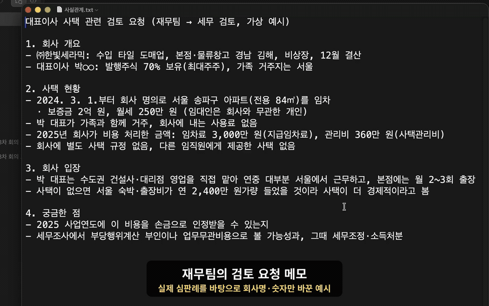
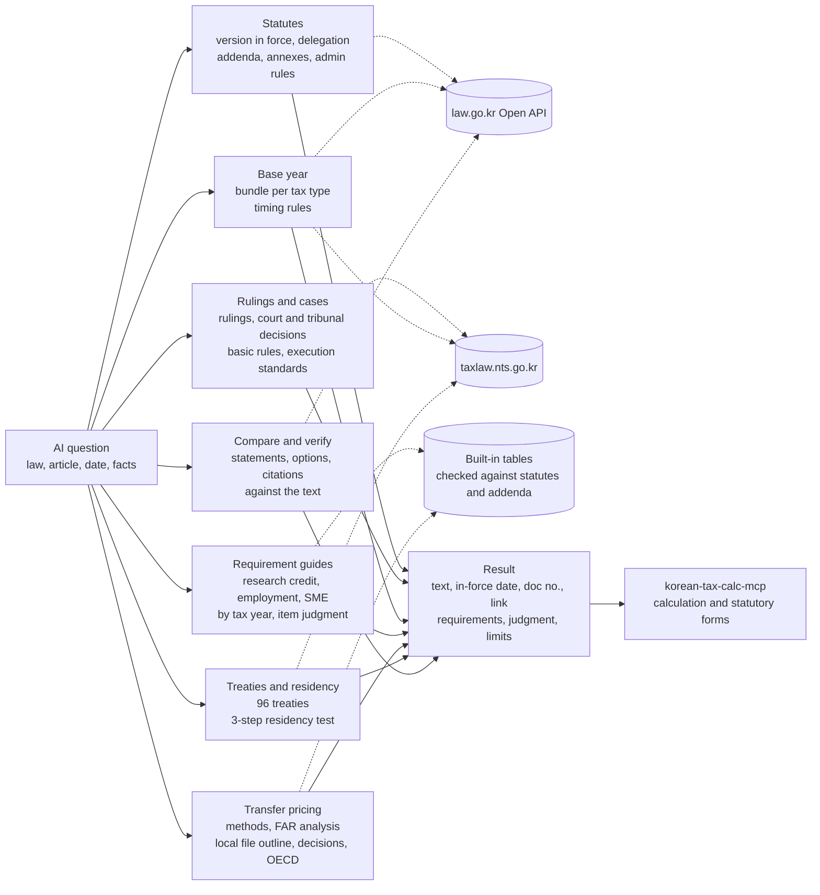

# korean-tax-mcp — Korea Tax Law MCP

<!-- mcp-name: io.github.UpstageAI/korean-tax-mcp -->



[](https://www.upstage.ai/)

> **Authorship notice:** Versions 0.7.0–0.11.1 (2026-10-13 to 10-19) were written by **Solar Pro 4** (Solar Work CLI), reviewed by CodeSolar and cross-checked with tests by Claude (in 0.10.0 only the table of contents was Solar's; the rest was written by Claude). **From 0.12.0 (2026-10-28) on, the existing skeleton remains Solar Pro 4's, while audits, bug fixes and additions are written by Claude (Anthropic)** and reviewed by CodeSolar. Each [CHANGELOG](CHANGELOG.md) section states who wrote it. 37 tools.

**Korea tax law for AI agents** — statutes as in force on any date, NTS rulings and court decisions, basic rules and treaties. [한국어](README.md)

---

## How it works



1. **Statutes** — picks the version in force on the base date from law.go.kr and returns the text with provisos and Act → Decree → Rule links. Without a date, today is used. Addenda (`article_addenda`) show from when an amendment applies; annexes are read with `law_article` ('Annex 1' style). Names not found among statutes (administrative rules such as the Foreign Exchange Transactions Regulation) are looked up as administrative rules.
2. **Rulings and cases** — searches the NTS system for rulings, court and tribunal decisions, basic rules and execution standards, with document numbers, links and full text. A question with several issues is searched issue by issue (`search_rulings_by_issue`). Local-tax questions also get Tax Tribunal decisions from law.go.kr. Wins and losses on the same issue can be compared (`compare_outcomes`), or matched against your facts (`compare_with_case`).
3. **Base year** — gathers the statute, basic rules and rulings for the base date of each tax type and flags changes against today's text. Timing rules (income recognition, VAT supply time) come first from the `timing_rules` table (90 rules).
4. **Requirement guides** — for incentives whose conditions change by tax year, returns the conditions checked against that year's statute and addenda: R&D tax credit (`rnd_credit_requirements_guide`, 2016–2026), employment credits (`employment_credit_requirements_guide`, 2018–2026) and SME incentives (`sme_tax_incentives_guide`). Given a list of employees or costs, it judges each item and lists what could not be confirmed. `tax_crime_guide` covers the Punishment of Tax Offenses Act by the date of the act.
5. **Transfer pricing** — applicable rules and arm's-length methods (`transfer_pricing_guide`), functions-assets-risks analysis (`transfer_pricing_far`), the 24-item local file outline (`transfer_pricing_report`), decisions on 9 issues (`transfer_pricing_cases`) and OECD Guidelines paragraphs (`oecd_tp_guidelines`). It does not compute or judge an arm's-length price.
6. **Treaties and residency** — text of 96 tax treaties (Korean and English), reduced rates on dividends, interest and royalties, and a 3-step resident / non-resident test (`residency_check`).
7. **Compare and verify** — checks statements and options against the statute text word by word (`verify_statement`, `judge_options`) and checks that cited document numbers and articles exist (`verify_citations`).

Judgment and conclusions stay with your AI and a professional. This server fetches the sources; amounts and statutory forms are handled by [korean-tax-calc-mcp](https://github.com/UpstageAI/korean-tax-calc-mcp).

## Sources

| Source | Scope | Where from | Tools |
|---|---|---|---|
| Statutes (Acts, Decrees, Rules) | version in force, history, addenda, annexes and forms | law.go.kr Open API (per call) | `law_article`, `find_article`, `article_history`, `article_addenda`, `search_forms` |
| Administrative rules | notices, directives, e.g. Foreign Exchange Transactions Regulation | law.go.kr Open API | `law_article` |
| Rulings, court and tribunal decisions | summary search and full text | taxlaw.nts.go.kr | `search_tax_rulings`, `search_rulings_by_issue`, `get_tax_ruling`, `rulings_by_article` |
| Tax Tribunal decisions | national and local taxes | law.go.kr | `search_tribunal_decisions`, `get_tribunal_decision` |
| Basic rules, execution standards | full text of basic rules; item, page and link for execution standards | taxlaw.nts.go.kr | `basic_rules`, `execution_standards` |
| Tax treaties | 96 treaties (Korean and English), reduced rates | taxlaw.nts.go.kr | `tax_treaty`, `treaty_withholding_rates` |
| NTS publications | full-text search | taxlaw.nts.go.kr | `search_nts_publications` |
| NTS 2025 casebook of tax interpretations | 96 cases | bundled | `casebook_search` |
| OECD Transfer Pricing Guidelines 2022 | 1,391 paragraphs (English), crosswalk to Korean law | bundled | `oecd_tp_guidelines` |
| Timing rules | 90 rules on tax liability, income recognition, supply time | bundled (checked against statutes) | `timing_rules` |
| Transfer pricing tables | methods, 24-item local file outline, decisions on 9 issues | bundled | `transfer_pricing_guide`, `transfer_pricing_far`, `transfer_pricing_report`, `transfer_pricing_cases` |
| Tax crime rules | acts on or after 2016-01-01 — Punishment of Tax Offenses Act art. 3–22, Aggravated Punishment Act art. 8, 8-2, 16 | bundled (checked against the versions in force 2015-12-29, 2019-01-01, 2021-01-01 and the 2018 addenda) | `tax_crime_guide` |
| Incentive requirement rules | R&D 2016–2026, employment 2018–2026, SME incentives | bundled (checked against each year's statute, addenda and rulings) | `rnd_credit_requirements_guide`, `employment_credit_requirements_guide`, `sme_tax_incentives_guide` |
| Residency rules | Income Tax Act art. 1-2, Decree arts. 2, 2-2, 3, treaty tie-breaker | bundled, treaties fetched | `residency_check`, `residency_report` |
| Your own documents | PDFs in a folder you set | local (`KOREAN_TAX_MCP_DOCS`) | `search_local_documents` |

Bundled tables return the statute version and the date they were checked. Re-check against the statute for your tax year with `law_article` (`as_of`).

## Install

```bash
claude mcp add korean-tax -- uvx korean-tax-mcp
```

```json
{
  "mcpServers": {
    "korean-tax": {
      "command": "uvx",
      "args": ["korean-tax-mcp"],
      "env": { "LAW_OC": "optional", "UPSTAGE_API_KEY": "optional" }
    },
    "korean-tax-calc": { "command": "uvx", "args": ["korean-tax-calc-mcp"] }
  }
}
```

The second entry, [korean-tax-calc-mcp](https://github.com/UpstageAI/korean-tax-calc-mcp), is the companion server: it turns the statutes and rulings found here into computed amounts, limits and determinations (126 tools) and fills the statutory Excel forms. With both installed, "find the basis → compute → fill the form" runs in one conversation. The first entry alone is enough for statutes and cases.

| Key | Used for |
|---|---|
| none | rulings, basic rules, standards, casebook, treaties, forms, publications, outcome comparison, residency check |
| `LAW_OC` (free, [open.law.go.kr](https://open.law.go.kr)) | statute lookup, find, history, base-year bundle, statement comparison, citation check (statutes) |
| `UPSTAGE_API_KEY` (optional) | Solar does fact comparison, outcome summaries and translation; otherwise your AI does |
| `KOREAN_TAX_MCP_SOLAR_BASE_URL` (optional) | in-house Solar on a closed network |

- **Data transmission** — By default the server calls only the public APIs of the Ministry of Government Legislation and the National Tax Service, and AI judgment, summaries and translation are done by your own AI — nothing is sent to Upstage. Optional: when `UPSTAGE_API_KEY` is set, Solar performs the comparison, summary and translation, and then the input is sent to the Upstage API (api.upstage.ai) — **do not enter personal or other sensitive data**. In air-gapped environments, set `KOREAN_TAX_MCP_SOLAR_BASE_URL` to an in-house Solar to avoid any external transmission.

## Recommended system prompt

Five rules that tell the AI when to call the tools and when to trust their answers. The server instructions carry the same rules, but some clients weight them lightly or ignore them. Adding the block below to your system prompt (Claude Desktop project instructions, Claude Code `CLAUDE.md`, or other custom instructions) makes the AI follow them more closely.

```text
When answering Korean tax questions, use korean-tax-mcp and korean-tax-calc-mcp as follows.
1. For every amount and every judgment, first check whether a tool exists. If you do not know the name, use find_tool; for timing of income or supply, check timing_rules first.
2. If a tool exists, call it before calculating by hand.
3. If the tool result differs from your own calculation, do not pick one right away. Recheck the inputs, open the deciding provision with law_article, and match its requirements to the facts one by one.
4. If no provision shows the tool is wrong, use the tool result. If you use a different value, state the reason (input error or article number) in one line.
5. If two values come out (before/after apportionment, total vs. taxable part, etc.), answer only the one the question asks for.
```

## Tools (37)

| Group | Tool | What it does |
|---|---|---|
| Statutes | `law_article` | text in force on a date, table of contents, delegation links, provisos |
| | `find_article` | find articles by keyword |
| | `article_history` | when an article changed, upcoming amendments |
| | `article_addenda` | addenda — from when an amendment applies (effective date, application rules, transitional rules) |
| Rulings | `search_tax_rulings` | rulings and court/tribunal decisions |
| | `search_rulings_by_issue` | split a multi-issue question and search per issue, most relevant plus recent per issue |
| | `get_tax_ruling` | full text of a document |
| | `search_tribunal_decisions` | Tax Tribunal decisions (special administrative ruling) search — national and local tax |
| | `get_tribunal_decision` | full text of one Tax Tribunal decision |
| | `rulings_by_article` | rulings citing a given article |
| | `basic_rules` | NTS basic rules |
| | `execution_standards` | execution standards: item, page, link |
| | `casebook_search` | NTS 2025 casebook (96 cases) |
| Base year · check | `research_issue` | statute, rules and rulings for the base date; changes vs today |
| | `timing_rules` | timing rules table — tax liability establishment, profit/loss attribution, income receipt timing, VAT supply timing |
| | `transfer_pricing_guide` | transfer pricing guide — applicable rule (ITA Act vs CITA art.52), arm's length methods, selection criteria, transaction-specific rules |
| | `transfer_pricing_report` | transfer pricing report outline following the Korean Local File form (24 items: how to write, facts, basis, OECD paragraphs, decisions) |
| | `transfer_pricing_far` | functions-assets-risks analysis — risk allocation steps, tested party candidate, method suitability and profit level indicators |
| | `sme_tax_incentives_guide` | SME tax incentives guide — startup reduction, venture startup, special reduction and loss carryback: eligibility, rates and statutory basis by founding date, region and industry |
| | `rnd_credit_requirements_guide` | R&D tax credit requirements by tax year — recognized lab, eligible staff, controlling-shareholder executives excluded, grant-funded spending excluded, excluded activities, records; per-person, per-cost and per-contractor checks (STTCA Enforcement Decree Table 6, Enforcement Rule Art. 7, 2016–2026) |
| | `employment_credit_requirements_guide` | Employment tax credit requirements by tax year — regular and youth-or-equivalent employees, headcount rules, follow-up rules, overlap with the startup reduction, carryforward, with per-employee checks (STTCA Art. 29-7 and 29-8, 2018–2026) |
| | `tax_crime_guide` | Tax crime provisions as in force on the date of the act — applicable article, elements, statutory penalty, amount thresholds, aggravated punishment, complaint requirement, limitation period, corporate liability (acts from 2016-01-01) |
| | `tax_crime_procedure_guide` | Tax crime investigation procedure by date — selection triggers, deliberation committee, investigation, notice disposition/complaint/no-charge, who decides, complaint duties, deadlines, limitation suspension (from 2016-01-01) |
| | `transfer_pricing_cases` | transfer pricing decisions by issue (9 issues) — taxpayer wins and upheld assessments side by side |
| | `oecd_tp_guidelines` | OECD Transfer Pricing Guidelines 2022 — paragraph lookup, keyword search, crosswalk to the Korean statute (1,391 paragraphs) |
| | `verify_citations` | do cited document numbers and articles exist |
| Compare · judge | `verify_statement` | one statement vs statute text |
| | `judge_options` | several options vs articles at once |
| | `compare_outcomes` | taxpayer wins vs losses on one issue |
| | `compare_with_case` | your facts vs rulings: supports / contradicts / distinguish |
| Treaties · residency | `tax_treaty` | treaties with 96 countries (Korean / English) |
| | `treaty_withholding_rates` | withholding caps on dividends, interest, royalties |
| | `residency_check` | 3-stage residence determination (rules) |
| | `residency_report` | review report (Solar) |
| Documents | `search_forms` | annexes and official forms |
| | `search_nts_publications` | NTS guidebooks |
| | `search_local_documents` | PDFs on your PC (`KOREAN_TAX_MCP_DOCS`) |

## English output

Every tool takes `lang="en"`:

- English field names and labels (`doc_no`, `summary`, `effective_date`, …)
- Tax treaties: official English text
- Statutes: official English translation from the Korea Legislation Research Institute (not legally binding; the Korean text prevails). Requires your `LAW_OC` key to be approved for English laws (open.law.go.kr → OPEN API → 영문법령)
- Rulings, decisions, basic rules: originals are Korean only. By default they are returned in Korean with a `host_ai_translate` instruction so your AI translates them (nothing sent to Upstage). Optionally, with `UPSTAGE_API_KEY`, titles and summaries are machine-translated by Upstage Solar (originals kept in `*_ko`); full texts stay Korean

Ask your agent in English, e.g. *"Find recent NTS rulings on deemed interest for loans to related parties (lang=en)"* or *"Show the dividend article of the Korea–US tax treaty in English."*

## Disclaimer

Results from this tool are **not tax advice**. They are reference material that finds and shows tax-law sources. For actual filing, tax audits, or appeals, consult a qualified professional (tax accountant, CPA, or attorney). Verify rulings, decisions, and statutes by following the original source links.

This tool does not perform **tax agent services under Article 2 of the Certified Tax Accountant Act** (preparing tax adjustment statements, representing filings or appeals, tax consultation); only certified tax accountants and registered CPAs or attorneys may do so (Article 20). It is software that finds and shows public statutes, rulings and decisions. The demo's "audit issue research" scene shows retrieval and organisation only — it does not judge facts or propose a response strategy. Please confirm the facts and your response together with a tax professional (tax accountant, CPA or attorney).

## AI use notice

- **Lookups, searches, and residence rule determinations** (`search_tax_rulings`, `get_tax_ruling`, `law_article`, `residency_check`, etc.) are performed by code — no generative AI is involved.
- **Results written by generative AI**: fact comparison (`compare_with_case`), win/loss summary (`compare_outcomes` with `explain=True`), English translation (`lang="en"`), and the residence review report (`residency_report`) are written by generative AI (default: your own AI; optional: Upstage Solar Pro 4).
- When Solar writes a result (`mode: "solar_cloud"` or `"solar_onprem"`), the result includes an `AI 생성 표시` field, in line with Article 31 of the Basic Act on the Development and Trustworthy Use of Artificial Intelligence.
- When your own AI judges (`mode: "host_ai"`), no AI generation marker is added to the result; instead the instruction text includes "표시하세요" (mark it as AI-generated when presenting to the user). The actual marking is performed by your AI tool.

## License

MIT © 2026 Upstage · Created by Mia (Seungmi Yoon)
