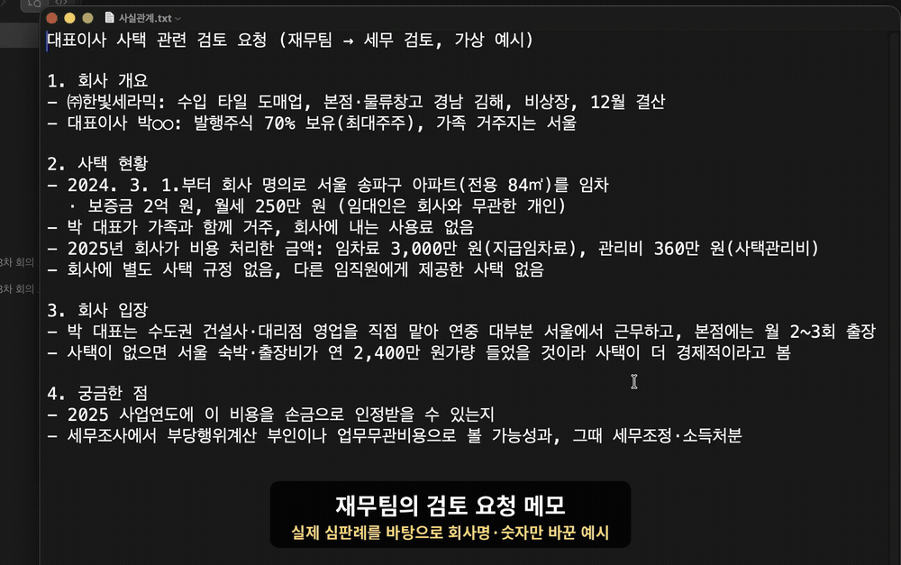
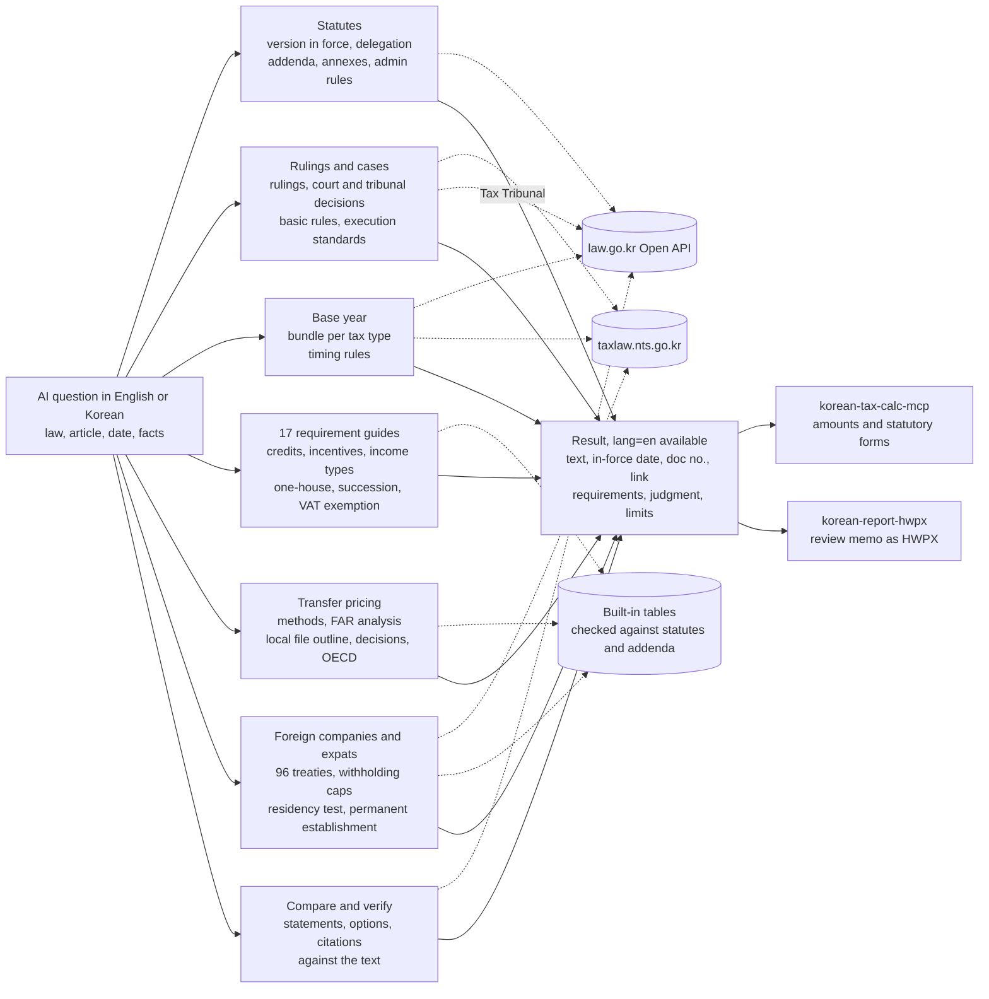
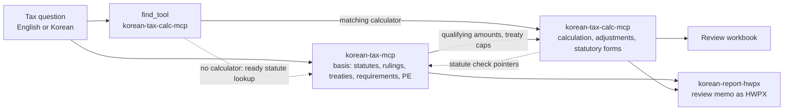

# korean-tax-mcp — Korea Tax Law MCP

<!-- mcp-name: io.github.UpstageAI/korean-tax-mcp -->

[](https://pypi.org/project/korean-tax-mcp/) [](https://registry.modelcontextprotocol.io/v0/servers?search=korean-tax-mcp) [](https://github.com/UpstageAI/korean-tax-mcp/blob/main/LICENSE) [](https://www.upstage.ai/) · [한국어](https://github.com/UpstageAI/korean-tax-mcp/blob/main/README.md)

**Korea (South Korea) tax law for AI agents.** Ask a Korean tax question and this MCP server returns **the statute as in force on the relevant date, NTS rulings, court cases and Tax Tribunal decisions, with document numbers and links** (52 tools — 51 read-only; `build_tax_memo` alone writes one Word file). It covers addenda and annexes, NTS basic rules and execution standards, 96 tax treaties and treaty withholding rates, a 3-step residency test, a permanent establishment (PE) test, transfer pricing, and 17 requirement guides whose conditions change by tax year (tax credits and incentives, income types, one-house exemption, family business succession, VAT exemption, nominee property, tax crimes). Every tool takes `lang="en"`. Amounts and statutory forms come from the companion server [korean-tax-calc-mcp](https://github.com/UpstageAI/korean-tax-calc-mcp) (140 tools).



<sub>Video: Claude app (Cowork) + this server + [korean-report-hwpx](https://github.com/UpstageAI/korean-report-hwpx). A "company-provided house for the CEO" case (based on Tax Tribunal decision 조심2017부0367, with company names and figures changed) is analysed requirement by requirement, similar tribunal decisions are attached, and a draft review memo is produced (published 2026-11-08).</sub>

> Not tax advice. Results show sources and computations for review; confirm filings and appeals with a tax professional. AI-generated parts are marked — [full notices](#disclaimer-and-ai-notice).

## Install

```bash
claude mcp add korean-tax -- uvx korean-tax-mcp
```

```json
{
  "mcpServers": {
    "korean-tax": {
      "command": "uvx",
      "args": ["korean-tax-mcp"],
      "env": { "LAW_OC": "optional", "UPSTAGE_API_KEY": "optional" }
    },
    "korean-tax-calc": { "command": "uvx", "args": ["korean-tax-calc-mcp"] },
    "korean-report-hwpx": { "command": "uvx", "args": ["korean-report-hwpx"] }
  }
}
```

Most tools work without any key. Only statute lookups and Tax Tribunal decisions need `LAW_OC` (free, [open.law.go.kr](https://open.law.go.kr)). The last two entries (calculator and document companions) are optional.

## How it works



Judgment and conclusions stay with your AI and a professional. This server fetches the sources.

## Try asking

| Question | Tool |
|---|---|
| *"Find recent NTS rulings on deemed interest for loans to related parties (lang=en)."* | `search_tax_rulings` → `get_tax_ruling` |
| *"Show Corporate Tax Act Enforcement Rule Art. 43 as in force on 2023-12-31."* | `law_article` (`as_of`) |
| *"What is the treaty cap on royalties a Korean subsidiary pays to its US parent? Quote the clause."* | `treaty_withholding_rates` |
| *"We pay patent royalties to our US parent and the patent is not registered in Korea. What rate do we withhold, and when must the reduced-rate application be received?"* | `royalty_withholding_guide` → `treaty_withholding_rates` |
| *"A US citizen seconded to Seoul spent 200 days in Korea last year; family stays in the US. Is she a Korean tax resident?"* | `residency_check` → `residency_report` |
| *"Our US engineers will install equipment at a Korean plant for 7 months. Does that create a permanent establishment?"* | `permanent_establishment_guide` → `tax_treaty` |
| *"Which transfer pricing method applies to sales to our US distributor? Show decisions too."* | `transfer_pricing_guide` → `transfer_pricing_cases` |
| *"Summarise this NTS ruling in English."* | `get_tax_ruling` with `lang="en"` |
| *"Turn the sources and numbers we found into a tax memo (Word)."* | `tax_memo_guide` → statute, treaty and calculator tools → `build_tax_memo` |
| *"Gather the statute, basic rules and rulings on Corporate Tax Act Art. 52 for the 2019 business year."* | `research_issue` |

**Links** — [Korean README](https://github.com/UpstageAI/korean-tax-mcp/blob/main/README.md) · [Site](https://upstageai.github.io/korean-tax-mcp/) · [Use cases for foreign companies and expats](https://upstageai.github.io/korean-tax-mcp/use-cases/) · [llms.txt](https://github.com/UpstageAI/korean-tax-mcp/blob/main/llms.txt) · [CHANGELOG](https://github.com/UpstageAI/korean-tax-mcp/blob/main/CHANGELOG.md) · companions [korean-tax-calc-mcp](https://github.com/UpstageAI/korean-tax-calc-mcp) (calculation) · [korean-report-hwpx](https://github.com/UpstageAI/korean-report-hwpx) (HWPX documents)

---

<details>
<summary><b>How it works in detail</b></summary>

1. **Statutes** — picks the version in force on the base date from law.go.kr and returns the text with provisos and Act → Decree → Rule links. Without a date, today is used. Addenda (`article_addenda`) show from when an amendment applies; annexes are read with `law_article` ('Annex 1' style). Names not found among statutes (administrative rules such as the Foreign Exchange Transactions Regulation) are looked up as administrative rules.
2. **Rulings and cases** — searches the NTS system for rulings, court and tribunal decisions, basic rules and execution standards, with document numbers, links and full text. A question with several issues is searched issue by issue (`search_rulings_by_issue`). Tax Tribunal decisions come from law.go.kr (special administrative appeal decisions; `search_tribunal_decisions`, `get_tribunal_decision`, `LAW_OC` needed), and local-tax questions get them added in the same call. Wins and losses on the same issue can be compared (`compare_outcomes`), or matched against your facts (`compare_with_case`).
3. **Base year** — gathers the statute, basic rules and rulings for the base date of each tax type and flags changes against today's text. Timing rules (income recognition, VAT supply time) come first from the `timing_rules` table (90 rules).
4. **Requirement guides** — for rules whose conditions change by tax year or date of the act, returns the conditions checked against that year's statute and addenda: R&D tax credit (`rnd_credit_requirements_guide`, 2016–2026), employment credits (`employment_credit_requirements_guide`, 2018–2026), SME incentives (`sme_tax_incentives_guide`), seven income types (wage, interest, dividend, business, pension, other, retirement — `wage_income_guide` etc., 2016–2026), one-house CGT exemption (`one_house_exemption_guide`), family business succession (`family_business_succession_guide`), VAT exemption and zero rating (`vat_exempt_zero_rate_guide`), nominee-held property (`nominee_trust_guide`), tax crime provisions (`tax_crime_guide`) and investigation procedure (`tax_crime_procedure_guide`). Given a list of employees or costs, the credit guides judge each item. What could not be confirmed is listed under limits.
5. **Transfer pricing** — applicable rules and arm's-length methods (`transfer_pricing_guide`), functions-assets-risks analysis (`transfer_pricing_far`), the 24-item local file outline (`transfer_pricing_report`), decisions on 9 issues (`transfer_pricing_cases`) and OECD Guidelines paragraphs (`oecd_tp_guidelines`). It does not compute or judge an arm's-length price.
6. **Treaties, residency and PE** — text of 96 tax treaties (Korean and English), reduced rates on dividends, interest and royalties, and a 3-step resident / non-resident test (`residency_check`). `permanent_establishment_guide` tests a Korean permanent establishment element by element under Corporate Tax Act Art. 94 and Income Tax Act Art. 120 (2016–2026).
7. **Compare and verify** — checks statements and options against the statute text word by word (`verify_statement`, `judge_options`) and checks that cited document numbers and articles exist (`verify_citations`).

</details>

<details>
<summary><b>Using the three servers together</b></summary>



[korean-tax-calc-mcp](https://github.com/UpstageAI/korean-tax-calc-mcp) turns the statutes and rulings found here into computed amounts, limits and determinations (140 tools) and fills the statutory Excel forms (corporate tax forms, VAT return, withholding return and more, with a summary sheet). [korean-report-hwpx](https://github.com/UpstageAI/korean-report-hwpx) turns the findings into an agency-format review memo or report in HWPX (Hangul). With all of them installed, "find the basis → compute → fill the form" runs in one conversation. This server alone is enough for statutes and cases.

</details>

<details>
<summary><b>For foreign companies, expats and Korean subsidiaries</b></summary>

If you are a foreign parent company with a Korean subsidiary, a Korean company paying foreign suppliers, an expat working in Korea, or an adviser to any of them, these tools cover the cross-border questions. All of them take `lang="en"`.

| Question | Tool |
|---|---|
| Am I (or my seconded employee) a Korean tax resident? Which country wins under the treaty tie-breaker? | `residency_check` (rules, no key), then `residency_report` for a written review |
| Does a foreign company or non-resident have a permanent establishment in Korea under domestic law? | `permanent_establishment_guide` (Corporate Tax Act Art. 94 and 94-2, Income Tax Act Art. 120, by year 2016–2026), then `tax_treaty` for the treaty PE article |
| What does the Korea–X treaty say on residence, business profits, permanent establishment, etc.? | `tax_treaty` — 96 treaties, official English text where available |
| What is the treaty cap on dividends, interest or royalties paid to country X, and does it include local income tax? | `treaty_withholding_rates` — each rate with its own clause, shareholding condition, and the PE, related-party, source-rule and benefit-limitation clauses |
| What rate applies to royalties (patent, know-how, trademark, copyright, software) paid to a foreign company, and what is the procedure? | `royalty_withholding_guide` — element-by-element judgment (characterization → Korean source → rate → procedure → gross-up → transfer pricing) and a decision path to 0, 10, 15 or 20 percent; compute the tax with `nonresident_withholding` in the calculation MCP |
| Which transfer pricing rule and method applies to an intercompany transaction? How do I write the Local File? | `transfer_pricing_guide`, `transfer_pricing_far`, `transfer_pricing_report`, `transfer_pricing_cases`, `oecd_tp_guidelines` |
| What do the NTS guidebooks say? | `search_nts_publications` — full text of NTS publications, including the 2026 tax guidebook for companies expanding overseas (해외진출기업을 위한 세무 가이드북), the tax guide for foreign corporations and foreign-invested companies (외국법인 및 외국인투자기업 납세안내) and the year-end tax settlement guide for foreigners |
| Flat tax rate for foreign employees, overseas work allowance, dividend and interest withholding, VAT zero-rating for services to foreign businesses | `wage_income_guide`, `dividend_income_guide`, `interest_income_guide`, `vat_exempt_zero_rate_guide` |
| How has the NTS ruled on this cross-border issue? | `search_tax_rulings` with `tax="국조"` (international tax), then `get_tax_ruling` |

Example questions:

- *"What is the treaty withholding rate on royalties a Korean subsidiary pays to its US parent? Quote the clause and tell me whether local income tax is on top (lang=en)."*
- *"A US citizen is seconded to our Seoul subsidiary for two years and keeps a home in the US. Is she a Korean tax resident for 2026, and how does the Korea–US treaty tie-breaker apply?"*
- *"Search the NTS publications for what the 2026 overseas-expansion tax guidebook says about reporting overseas subsidiaries."*

For the numbers — withholding tax on payments to non-residents (`nonresident_withholding`), VAT reverse charge on services from foreign suppliers (`vat_reverse_charge`), expat cost recharges (`expat_cost_recharge`), dividends from foreign subsidiaries (`foreign_subsidiary_dividend`), the flat tax for foreign workers (`foreign_worker_flat_tax`), the foreign expert reduction (`foreign_expert_income_reduction`), branch profits tax (`branch_profits_tax`), non-resident capital gains withholding (`nonresident_capital_gains_withholding`), non-resident inheritance and gift tax (`nonresident_inheritance_gift`), exit tax on emigration (`emigration_exit_tax`), foreign tax credits and CFC rules — install the companion [korean-tax-calc-mcp](https://github.com/UpstageAI/korean-tax-calc-mcp). Worked examples with real calls and results: [use cases](https://upstageai.github.io/korean-tax-mcp/use-cases/).

</details>

<details>
<summary><b>English output</b></summary>

Every tool takes `lang="en"`:

- English field names and labels (`doc_no`, `summary`, `effective_date`, …)
- Tax treaties: official English text
- Statutes: official English translation from the Korea Legislation Research Institute (not legally binding; the Korean text prevails). Requires your `LAW_OC` key to be approved for English laws (open.law.go.kr → OPEN API → 영문법령)
- Rulings, decisions, basic rules: originals are Korean only. By default they are returned in Korean with a `host_ai_translate` instruction so your AI translates them (nothing sent to Upstage). Optionally, with `UPSTAGE_API_KEY`, titles and summaries are machine-translated by Upstage Solar (originals kept in `*_ko`); full texts stay Korean

Ask your agent in English, e.g. *"Find recent NTS rulings on deemed interest for loans to related parties (lang=en)"* or *"Show the dividend article of the Korea–US tax treaty in English."*

</details>

<details>
<summary><b>For agent developers</b></summary>

- Tool names are English, and every tool description starts with a one-line English summary followed by the Korean description. A question → tool table is in [llms.txt](https://github.com/UpstageAI/korean-tax-mcp/blob/main/llms.txt).
- If you build an agent with Anthropic's BM25 tool search (`tool_search_tool_bm25`), it does not match Hangul queries — search with English keywords (tool descriptions start with English) or use the regex tool search (`tool_search_tool_regex`), which matches Korean terms. Verified 2026-11-14: Korean words present verbatim in the descriptions returned 0 results; English keywords matched.

</details>

<details>
<summary><b>All tools (52)</b></summary>

| Group | Tool | What it does |
|---|---|---|
| Statutes (4) | `law_article` | text in force on a date, table of contents, delegation links, provisos |
| | `find_article` | find articles by keyword |
| | `article_history` | when an article changed, upcoming amendments |
| | `article_addenda` | addenda — from when an amendment applies (effective date, application rules, transitional rules) |
| Rulings and cases (9) | `search_tax_rulings` | rulings and court/tribunal decisions |
| | `search_rulings_by_issue` | split a multi-issue question and search per issue, most relevant plus recent per issue |
| | `get_tax_ruling` | full text of a document |
| | `search_tribunal_decisions` | Tax Tribunal decisions (special administrative appeal decisions) search — national and local tax |
| | `get_tribunal_decision` | full text of one Tax Tribunal decision |
| | `rulings_by_article` | rulings citing a given article |
| | `basic_rules` | NTS basic rules |
| | `execution_standards` | execution standards: item, page, link |
| | `casebook_search` | NTS 2025 casebook (96 cases) |
| Base year (2) | `research_issue` | statute, rules and rulings for the base date; changes vs today |
| | `timing_rules` | timing rules table — tax liability establishment, profit/loss attribution, income receipt timing, VAT supply timing |
| Requirement guides (16) | `rnd_credit_requirements_guide` | R&D tax credit requirements by tax year — recognized lab, eligible staff, controlling-shareholder executives excluded, grant-funded spending excluded, excluded activities, records; per-person, per-cost and per-contractor checks (STTCA Enforcement Decree Table 6, Enforcement Rule Art. 7, 2016–2026) |
| | `employment_credit_requirements_guide` | Employment tax credit requirements by tax year — regular and youth-or-equivalent employees, headcount rules, follow-up rules, overlap with the startup reduction, carryforward, with per-employee checks (STTCA Art. 29-7 and 29-8, 2018–2026) |
| | `sme_tax_incentives_guide` | SME tax incentives guide — startup reduction, venture startup, special reduction and loss carryback: eligibility, rates and statutory basis by founding date, region and industry |
| | `interest_income_guide` | Interest income guide by payment date — scope, private lending vs. lending business, savings-insurance exemption, separate taxation and KRW 20M threshold, withholding rates (2016–2026) |
| | `dividend_income_guide` | Dividend income guide by payment date — scope and deemed dividends, gross-up eligibility and rate (10% for payments from 2024-01-01), KRW 20M threshold, withholding, timing, dividend credit outline (2016–2026) |
| | `wage_income_guide` | Wage income requirements by tax year and payment date — tax-exempt allowance caps (meals, own car, childcare, childbirth support, overtime, overseas work, invention pay), daily-worker status, flat rate for foreign employees (2016–2026) |
| | `business_income_guide` | Business income requirements by tax year — scope, exemptions (one-house rental 0.9→1.2bn), house rental separate taxation and deemed rent, bookkeeping duty, sincere-filing confirmation, expense ratios (2016–2026) |
| | `pension_income_guide` | Pension income requirements by receipt date — public vs. account pensions, pension-type withdrawal conditions, other withdrawals, unavoidable withdrawals, separate-taxation threshold (12M→15M), withholding, exemptions (2016–2026) |
| | `other_income_guide` | Other income requirements — item, deemed expense rate (80→70→60%), minimum threshold, separate taxation, withholding, exemptions (2016–2026) |
| | `retirement_income_guide` | Retirement income requirements by retirement date — scope, actual retirement, interim settlement, executive cap (3x 2012–2019, 2x from 2020), service-years deduction (2023 table), deferral (2016–2026) |
| | `one_house_exemption_guide` | One-house household CGT exemption by transfer date — holding/residence periods, adjustment-area residence rule, temporary two-house disposal deadlines, high-priced house threshold (KRW 0.9bn/1.2bn), inheritance/elderly-parent/marriage/rural-house special cases (2016–2026) |
| | `family_business_succession_guide` | Family business inheritance deduction requirements by date of inheritance — revenue cap, deduction cap, decedent and heir requirements, post-inheritance management and recapture, payment deferral (2016–2026) |
| | `vat_exempt_zero_rate_guide` | VAT exemption and zero-rating by supply date — exempt supplies (Art. 26), waiver, zero-rating (Arts. 21–25, Decree Art. 33 conditions) and attachments (2016–2026) |
| | `nominee_trust_guide` | Deemed gift on nominee-held property (IGTA Art. 45-2) by deemed gift date — covered assets, tax-avoidance presumption and rebuttal, failure to transfer title, timing and valuation date, taxpayer (actual owner from 2019-01-01, nominee's property liability), aggregation, assessment period, repeated-taxation case law, corporate links, Real Estate Real Name Act pointer (from 2016-01-01) |
| | `tax_crime_guide` | Tax crime provisions as in force on the date of the act — applicable article, elements, statutory penalty, amount thresholds, aggravated punishment, complaint requirement, limitation period, corporate liability (acts from 2016-01-01) |
| | `tax_crime_procedure_guide` | Tax crime investigation procedure by date — selection triggers, deliberation committee, investigation, notice disposition/complaint/no-charge, who decides, complaint duties, deadlines, limitation suspension (from 2016-01-01) |
| Transfer pricing (5) | `transfer_pricing_guide` | transfer pricing guide — applicable rule (ITA Act vs CITA art.52), arm's length methods, selection criteria, transaction-specific rules |
| | `transfer_pricing_far` | functions-assets-risks analysis — risk allocation steps, tested party candidate, method suitability and profit level indicators |
| | `transfer_pricing_report` | transfer pricing report outline following the Korean Local File form (24 items: how to write, facts, basis, OECD paragraphs, decisions) |
| | `transfer_pricing_cases` | transfer pricing decisions by issue (9 issues) — taxpayer wins and upheld assessments side by side |
| | `oecd_tp_guidelines` | OECD Transfer Pricing Guidelines 2022 — paragraph lookup, keyword search, crosswalk to the Korean statute (1,391 paragraphs) |
| Compare and judge (5) | `verify_citations` | do cited document numbers and articles exist |
| | `verify_statement` | one statement vs statute text |
| | `judge_options` | several options vs articles at once |
| | `compare_outcomes` | taxpayer wins vs losses on one issue |
| | `compare_with_case` | your facts vs rulings: supports / contradicts / distinguish |
| Tax memo (2) | `tax_memo_guide` | logic line for a tax memo or opinion — 3-point executive summary, question, short answer, facts and assumptions, issues in examiner order (characterization, taxability, rate, treaty, procedure, related taxes), calculation, risks, next steps, footnotes — with the JSON schema and an illustrative example of the shape (English / Korean, made-up case) |
| | `build_tax_memo` | validates the structure against that line (47 rules, incl. the optional blocks — key-figures table, review of past handling, action list, limitations — a check that a memo sent with Excel workings (`head.workings`) records how the workbook amounts were checked against the calculators (`workings_check`: `verify_workbook` on the workbook you built, or `export_workbook` for a statutory form, both in [korean-tax-calc-mcp](https://github.com/UpstageAI/korean-tax-calc-mcp); unchecked amounts go under limitations), and a length check against `target_pages`, default 5: rule/application/conclusion and a citation per issue, summary amounts vs the calculation table, totals, footnote ids …) and writes a Word .docx with real footnotes — no file on errors, warnings to fix and rebuild |
| Treaties, residency, PE (6) | `tax_treaty` | treaties with 96 countries (Korean / English) |
| | `treaty_withholding_rates` | withholding caps on dividends, interest, royalties |
| | `residency_check` | 3-stage residence determination (rules) |
| | `residency_report` | review report (your own AI by default, Solar optional) |
| | `permanent_establishment_guide` | Korean PE test under domestic law (CITA Art. 94, ITA Art. 120) by element and year, 2016-2026 |
| | `royalty_withholding_guide` | withholding on cross-border royalties: characterization, Korean source (CITA Art. 93 item 8), treaty cap, local income tax, procedure (Art. 98-6), gross-up, transfer pricing, by payment date 2016-2026, individual recipients under the Income Tax Act, with the 2025 en banc decision on unregistered patents |
| Documents (3) | `search_forms` | annexes and official forms |
| | `search_nts_publications` | NTS guidebooks |
| | `search_local_documents` | PDFs on your PC (`KOREAN_TAX_MCP_DOCS`) |

</details>

<details>
<summary><b>Sources</b></summary>

| Source | Scope | Where from | Tools |
|---|---|---|---|
| Statutes (Acts, Decrees, Rules) | version in force, history, addenda, annexes and forms | law.go.kr Open API (per call) | `law_article`, `find_article`, `article_history`, `article_addenda`, `search_forms` |
| Administrative rules | notices, directives, e.g. Foreign Exchange Transactions Regulation | law.go.kr Open API | `law_article` |
| Rulings, court and tribunal decisions | summary search and full text | taxlaw.nts.go.kr | `search_tax_rulings`, `search_rulings_by_issue`, `get_tax_ruling`, `rulings_by_article` |
| Tax Tribunal decisions | national and local taxes | law.go.kr | `search_tribunal_decisions`, `get_tribunal_decision` |
| Basic rules, execution standards | full text of basic rules; item, page and link for execution standards | taxlaw.nts.go.kr | `basic_rules`, `execution_standards` |
| Tax treaties | 96 treaties (Korean and English), reduced rates | taxlaw.nts.go.kr | `tax_treaty`, `treaty_withholding_rates` |
| NTS publications | full-text search | taxlaw.nts.go.kr | `search_nts_publications` |
| NTS 2025 casebook of tax interpretations | 96 cases | bundled | `casebook_search` |
| OECD Transfer Pricing Guidelines 2022 | 1,391 paragraphs (English), crosswalk to Korean law | bundled | `oecd_tp_guidelines` |
| Timing rules | 90 rules on tax liability, income recognition, supply time | bundled (checked against statutes) | `timing_rules` |
| Transfer pricing tables | methods, 24-item local file outline, decisions on 9 issues | bundled | `transfer_pricing_guide`, `transfer_pricing_far`, `transfer_pricing_report`, `transfer_pricing_cases` |
| Tax crime rules | acts on or after 2016-01-01 — Punishment of Tax Offenses Act art. 3–22, Aggravated Punishment Act art. 8, 8-2, 16 | bundled (checked against the versions in force 2015-12-29, 2019-01-01, 2021-01-01 and the 2018 addenda) | `tax_crime_guide`, `tax_crime_procedure_guide` |
| Incentive requirement rules | R&D 2016–2026, employment 2018–2026, SME incentives | bundled (checked against each year's statute, addenda and rulings) | `rnd_credit_requirements_guide`, `employment_credit_requirements_guide`, `sme_tax_incentives_guide` |
| Tax type and income type rules | Income Tax Act, Inheritance and Gift Tax Act, VAT Act, Real Estate Real Name Act, 2016–2026 versions and addenda | bundled | `interest_income_guide`, `dividend_income_guide`, `wage_income_guide`, `business_income_guide`, `pension_income_guide`, `other_income_guide`, `retirement_income_guide`, `one_house_exemption_guide`, `family_business_succession_guide`, `vat_exempt_zero_rate_guide`, `nominee_trust_guide` |
| Residency rules | Income Tax Act art. 1-2, Decree arts. 2, 2-2, 3, treaty tie-breaker | bundled, treaties fetched | `residency_check`, `residency_report` |
| Permanent establishment rules | Corporate Tax Act art. 94 and 94-2, Income Tax Act art. 120, 2016–2026 | bundled | `permanent_establishment_guide` |
| Your own documents | PDFs in a folder you set | local (`KOREAN_TAX_MCP_DOCS`) | `search_local_documents` |

Bundled tables return the statute version and the date they were checked. Re-check against the statute for your tax year with `law_article` (`as_of`).

</details>

<details>
<summary><b>Keys and data transmission</b></summary>

| Key | Used for |
|---|---|
| none | rulings, basic rules, standards, casebook, treaties, forms, publications, outcome comparison, requirement guides, transfer pricing, residency and PE tests |
| `LAW_OC` (free, [open.law.go.kr](https://open.law.go.kr)) | statute lookup, find, history, addenda, Tax Tribunal decisions, base-year bundle, statement comparison, citation check (statutes) |
| `UPSTAGE_API_KEY` (optional) | Solar does fact comparison, outcome summaries, translation and the residency report; otherwise your AI does |
| `KOREAN_TAX_MCP_SOLAR_BASE_URL` (optional) | in-house Solar on a closed network |
| `KOREAN_TAX_MCP_DOCS` (optional) | PDF folder searched by `search_local_documents` |

- **Data transmission** — By default the server calls only the public APIs of the Ministry of Government Legislation and the National Tax Service, and AI judgment, summaries, translation and the residency report are done by your own AI — nothing is sent to Upstage. Optional: when `UPSTAGE_API_KEY` is set, Solar performs the comparison, summary, translation and report, and then the input is sent to the Upstage API (api.upstage.ai) — **do not enter personal or other sensitive data**. In air-gapped environments, set `KOREAN_TAX_MCP_SOLAR_BASE_URL` to an in-house Solar to avoid any external transmission.

</details>

<details>
<summary><b>Recommended system prompt</b></summary>

Five rules that tell the AI when to call the tools and when to trust their answers. The server instructions carry the same rules, but some clients weight them lightly or ignore them. Adding the block below to your system prompt (Claude Desktop project instructions, Claude Code `CLAUDE.md`, or other custom instructions) makes the AI follow them more closely.

```text
When answering Korean tax questions, use korean-tax-mcp and korean-tax-calc-mcp as follows.
1. For every amount and every judgment, first check whether a tool exists. If you do not know the name, use find_tool (korean-tax-calc-mcp); for timing of income or supply, check timing_rules first.
2. If a tool exists, call it before calculating by hand.
3. If the tool result differs from your own calculation, do not pick one right away. Recheck the inputs, open the deciding provision with law_article, and match its requirements to the facts one by one.
4. If no provision shows the tool is wrong, use the tool result. If you use a different value, state the reason (input error or article number) in one line.
5. If two values come out (before/after apportionment, total vs. taxable part, etc.), answer only the one the question asks for.
```

</details>

<details>
<summary><b>Authorship and evaluation</b></summary>

**Authorship notice:** Versions 0.7.0–0.11.1 (2026-10-13 to 10-19) were written by **Solar Pro 4** (Solar Work CLI), reviewed by CodeSolar and cross-checked with tests by Claude (in 0.10.0 only the table of contents was Solar's; the rest was written by Claude). **From 0.12.0 (2026-10-28) on, the existing skeleton remains Solar Pro 4's, while audits, bug fixes and additions are written by Claude (Anthropic)** and reviewed by CodeSolar. **From 0.12.15 (2026-11-10), additions start with Claude writing the spec and answer tests, Solar Pro 4 implementing the skeleton, and Claude reviewing and completing it** (author marked per commit). Each [CHANGELOG](https://github.com/UpstageAI/korean-tax-mcp/blob/main/CHANGELOG.md) section states who wrote it.

**Evaluation:** an end-to-end evaluation in which Solar Pro 4 uses these MCP servers as tools to answer multiple-choice Korean tax questions is in the `eval/` folder. Per-tool accuracy is measured in `bench/`.

</details>

<details>
<summary><b>Notes</b></summary>

- Rulings and court decisions reflect the law at the time they were issued. Check the article in force for your tax year with `law_article` (`as_of`).
- NTS public lookups are cached for one day and spaced 0.5 seconds apart. Execution standards are given as item, page and link only.
- When the public services (law.go.kr, taxlaw.nts.go.kr) are slow or under maintenance, the affected tools return an error.
- For Korean law in general, pair it with [korean-law-mcp](https://github.com/chrisryugj/korean-law-mcp).

</details>

<details>
<summary><b>Disclaimer and AI notice (full text)</b></summary>

### Disclaimer and AI notice

**Disclaimer** — Results from this tool are **not tax advice**. They are reference material that finds and shows tax-law sources. For actual filing, tax audits, or appeals, consult a qualified professional (tax accountant, CPA, or attorney). Verify rulings, decisions, and statutes by following the original source links.

This tool does not perform **tax agent services under Article 2 of the Certified Tax Accountant Act** (preparing tax adjustment statements, representing filings or appeals, tax consultation); only certified tax accountants and registered CPAs or attorneys may do so (Article 20). It is software that finds and shows public statutes, rulings and decisions. The demo's "company-provided house for the CEO" review shows retrieval and organisation only — it does not judge facts or propose a response strategy. Please confirm the facts and your response together with a tax professional (tax accountant, CPA or attorney).

**AI use notice**

- **Lookups, searches and rule-based determinations** (`search_tax_rulings`, `get_tax_ruling`, `law_article`, `residency_check`, requirement guides, `permanent_establishment_guide`, etc.) are performed by code — no generative AI is involved.
- **Results written by generative AI**: fact comparison (`compare_with_case`), win/loss summary (`compare_outcomes` with `explain=True`), English translation (`lang="en"`), and the residence review report (`residency_report`) are written by generative AI (default: your own AI; optional: Upstage Solar Pro 4).
- When Solar writes a result (`mode: "solar_cloud"` or `"solar_onprem"`), the result includes an `AI 생성 표시` field, in line with Article 31 of the Basic Act on the Development and Trustworthy Use of Artificial Intelligence.
- When your own AI judges (`mode: "host_ai"`), no AI generation marker is added to the result; instead the instruction text includes "표시하세요" (mark it as AI-generated when presenting to the user). The actual marking is performed by your AI tool.

</details>

---

Sources: NTS Tax Law Information System (taxlaw.nts.go.kr) · Ministry of Government Legislation, National Law Information Open API · NTS "2025 Casebook of Tax Interpretations" · OECD "Transfer Pricing Guidelines for Multinational Enterprises and Tax Administrations 2022"

MIT © 2026 Upstage · Created by Mia (Seungmi Yoon)
