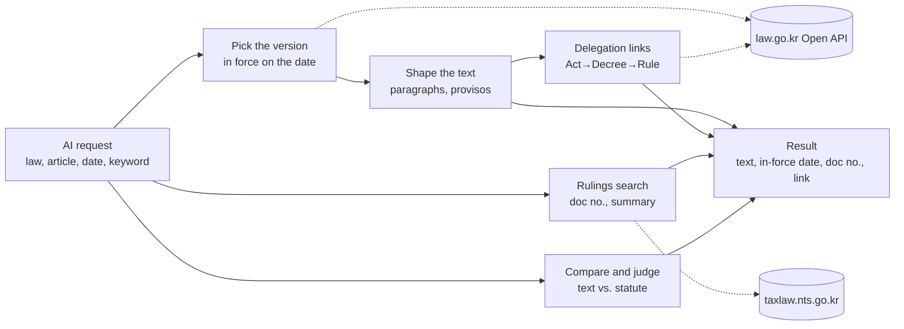

# korean-tax-mcp — Korea Tax Law MCP

<!-- mcp-name: io.github.UpstageAI/korean-tax-mcp -->


[](https://www.upstage.ai/)

> **Code has been written by Solar Pro 4 since 0.7.0**, reviewed by CodeSolar and cross-checked with tests by Claude. 22 tools — see [CHANGELOG](CHANGELOG.md).

**Korea tax law for AI agents** — statutes as in force on any date, NTS rulings and court decisions, basic rules and treaties. [한국어](README.md)

---

## How it works



1. **Statutes** — picks the version in force on the base date from law.go.kr and returns the text with provisos and Act → Decree → Rule links. Without a date, today is used.
2. **Rulings** — searches the NTS system for rulings, decisions, basic rules and execution standards, with document numbers and links.
3. **Base year** — gathers the statute and rulings for the base date of each tax type (fiscal year end, transfer date, …) and flags changes against today's text.
4. **Compare** — checks statements against the statute text word by word and marks differing numbers and provisos.

Judgment and conclusions stay with your AI and a professional; this server fetches the sources.

## Install

```bash
claude mcp add korean-tax -- uvx korean-tax-mcp
```

```json
{
  "mcpServers": {
    "korean-tax": {
      "command": "uvx",
      "args": ["korean-tax-mcp"],
      "env": { "LAW_OC": "optional", "UPSTAGE_API_KEY": "optional" }
    }
  }
}
```

| Key | Used for |
|---|---|
| none | rulings, basic rules, standards, casebook, treaties, forms, publications, outcome comparison, residency check |
| `LAW_OC` (free, [open.law.go.kr](https://open.law.go.kr)) | statute lookup, find, history, base-year bundle, statement comparison, citation check (statutes) |
| `UPSTAGE_API_KEY` (optional) | Solar does fact comparison, outcome summaries and translation; otherwise your AI does |
| `KOREAN_TAX_MCP_SOLAR_BASE_URL` (optional) | in-house Solar on a closed network |

- **Data transmission** — By default the server calls only the public APIs of the Ministry of Government Legislation and the National Tax Service, and AI judgment, summaries and translation are done by your own AI — nothing is sent to Upstage. Optional: when `UPSTAGE_API_KEY` is set, Solar performs the comparison, summary and translation, and then the input is sent to the Upstage API (api.upstage.ai) — **do not enter personal or other sensitive data**. In air-gapped environments, set `KOREAN_TAX_MCP_SOLAR_BASE_URL` to an in-house Solar to avoid any external transmission.

## Tools (22)

| Group | Tool | What it does |
|---|---|---|
| Statutes | `law_article` | text in force on a date, table of contents, delegation links, provisos |
| | `find_article` | find articles by keyword |
| | `article_history` | when an article changed, upcoming amendments |
| Rulings | `search_tax_rulings` | rulings and court/tribunal decisions |
| | `get_tax_ruling` | full text of a document |
| | `rulings_by_article` | rulings citing a given article |
| | `basic_rules` | NTS basic rules |
| | `execution_standards` | execution standards: item, page, link |
| | `casebook_search` | NTS 2025 casebook (96 cases) |
| Base year · check | `research_issue` | statute, rules and rulings for the base date; changes vs today |
| | `verify_citations` | do cited document numbers and articles exist |
| Compare · judge | `verify_statement` | one statement vs statute text |
| | `judge_options` | several options vs articles at once |
| | `compare_outcomes` | taxpayer wins vs losses on one issue |
| | `compare_with_case` | your facts vs rulings: supports / contradicts / distinguish |
| Treaties · residency | `tax_treaty` | treaties with 96 countries (Korean / English) |
| | `treaty_withholding_rates` | withholding caps on dividends, interest, royalties |
| | `residency_check` | 3-stage residence determination (rules) |
| | `residency_report` | review report (Solar) |
| Documents | `search_forms` | annexes and official forms |
| | `search_nts_publications` | NTS guidebooks |
| | `search_local_documents` | PDFs on your PC (`KOREAN_TAX_MCP_DOCS`) |

## English output

Every tool takes `lang="en"`:

- English field names and labels (`doc_no`, `summary`, `effective_date`, …)
- Tax treaties: official English text
- Statutes: official English translation from the Korea Legislation Research Institute (not legally binding; the Korean text prevails). Requires your `LAW_OC` key to be approved for English laws (open.law.go.kr → OPEN API → 영문법령)
- Rulings, decisions, basic rules: originals are Korean only. By default they are returned in Korean with a `host_ai_translate` instruction so your AI translates them (nothing sent to Upstage). Optionally, with `UPSTAGE_API_KEY`, titles and summaries are machine-translated by Upstage Solar (originals kept in `*_ko`); full texts stay Korean

Ask your agent in English, e.g. *"Find recent NTS rulings on deemed interest for loans to related parties (lang=en)"* or *"Show the dividend article of the Korea–US tax treaty in English."*

## Disclaimer

Results from this tool are **not tax advice**. They are reference material that finds and shows tax-law sources. For actual filing, tax audits, or appeals, consult a qualified professional (tax accountant, CPA, or attorney). Verify rulings, decisions, and statutes by following the original source links.

This tool does not perform **tax agent services under Article 2 of the Certified Tax Accountant Act** (preparing tax adjustment statements, representing filings or appeals, tax consultation); only certified tax accountants and registered CPAs or attorneys may do so (Article 20). It is software that finds and shows public statutes, rulings and decisions. The demo's "audit issue research" scene shows retrieval and organisation only — it does not judge facts or propose a response strategy. Please confirm the facts and your response together with a tax professional (tax accountant, CPA or attorney).

## AI use notice

- **Lookups, searches, and residence rule determinations** (`search_tax_rulings`, `get_tax_ruling`, `law_article`, `residency_check`, etc.) are performed by code — no generative AI is involved.
- **Results written by generative AI**: fact comparison (`compare_with_case`), win/loss summary (`compare_outcomes` with `explain=True`), English translation (`lang="en"`), and the residence review report (`residency_report`) are written by generative AI (default: your own AI; optional: Upstage Solar Pro 4).
- When Solar writes a result (`mode: "solar_cloud"` or `"solar_onprem"`), the result includes an `AI 생성 표시` field, in line with Article 31 of the Basic Act on the Development and Trustworthy Use of Artificial Intelligence.
- When your own AI judges (`mode: "host_ai"`), no AI generation marker is added to the result; instead the instruction text includes "표시하세요" (mark it as AI-generated when presenting to the user). The actual marking is performed by your AI tool.

## License

MIT © 2026 Upstage · Created by Mia (Seungmi Yoon)
