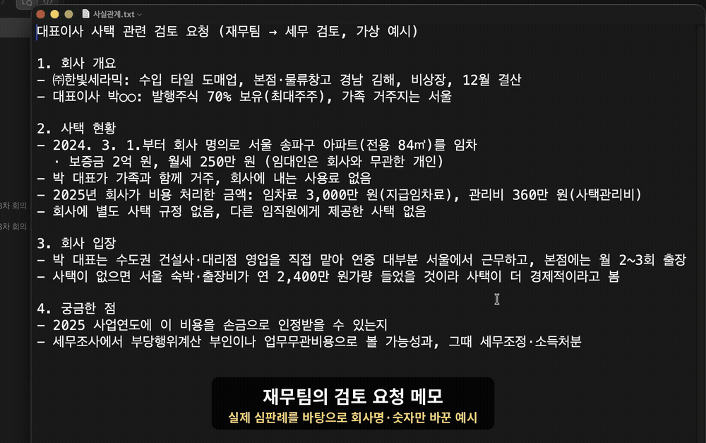
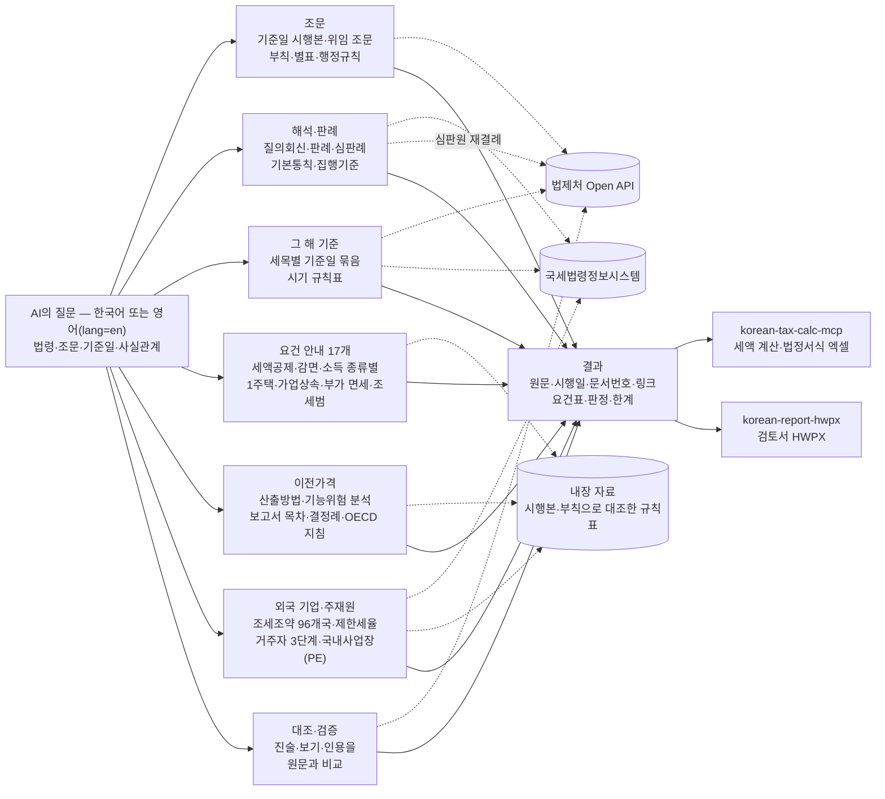
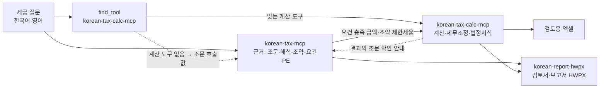

# korean-tax-mcp — Korea Tax Law MCP (한국 세법)

<!-- mcp-name: io.github.UpstageAI/korean-tax-mcp -->

[](https://pypi.org/project/korean-tax-mcp/) [](https://registry.modelcontextprotocol.io/v0/servers?search=korean-tax-mcp) [](https://github.com/UpstageAI/korean-tax-mcp/blob/main/LICENSE) [](https://www.upstage.ai/) · [English](https://github.com/UpstageAI/korean-tax-mcp/blob/main/README-EN.md)

세법 쟁점을 AI에 물으면 **그 시점에 시행 중이던 조문과 국세청 해석·판례·조세심판원 재결례를 문서번호·링크와 함께** 가져오는 MCP 서버입니다(도구 54개 — 53개는 읽기 전용, `build_tax_memo`만 Word 파일 하나를 저장). 기준일 시행본·부칙·별표, 국세 기본통칙·집행기준, 조세조약 96개국과 제한세율, 거주자 3단계 판정과 국내사업장(PE) 판정, 이전가격, 과세연도별 요건 안내 17개(세액공제·감면·소득 종류별·1세대 1주택·가업상속·부가 면세·명의신탁·조세범)를 다룹니다. 모든 도구는 `lang="en"`으로 영어 결과를 돌려줍니다. 금액 계산과 법정서식은 짝 서버 [korean-tax-calc-mcp](https://github.com/UpstageAI/korean-tax-calc-mcp)(도구 141개)가 맡습니다.



<sub>영상: Claude 앱(코워크) + 이 서버 + [korean-report-hwpx](https://github.com/UpstageAI/korean-report-hwpx). '대표이사 사택 제공' 사례(실제 심판례 조심2017부0367을 바탕으로 회사명·숫자만 바꾼 예시)로 요건별 법리를 따지고 유사 심판례를 붙여 검토서 초안까지 만듭니다(2026-11-08 공개).</sub>

> 세무 자문이 아닙니다. 결과는 근거·계산 과정을 보여 주는 참고 자료이며, 신고·불복 판단은 세무 전문가와 확인하세요. AI 생성 결과에는 표시가 붙습니다 — [면책·AI 고지 전문](#면책-및-ai-고지).

## 설치

```bash
claude mcp add korean-tax -- uvx korean-tax-mcp
```

```json
{
  "mcpServers": {
    "korean-tax": {
      "command": "uvx",
      "args": ["korean-tax-mcp"],
      "env": { "LAW_OC": "법제처 OC(선택)", "UPSTAGE_API_KEY": "Upstage 키(선택)" }
    },
    "korean-tax-calc": { "command": "uvx", "args": ["korean-tax-calc-mcp"] },
    "korean-report-hwpx": { "command": "uvx", "args": ["korean-report-hwpx"] }
  }
}
```

키 없이 대부분 동작합니다. 조문 조회와 조세심판원 재결례만 `LAW_OC`([open.law.go.kr](https://open.law.go.kr) 무료)가 필요합니다. 아래 두 줄(계산·공문서 짝 서버)은 선택입니다.

## 작동 방식



판단과 결론은 사용자의 AI와 전문가 몫입니다. 이 서버는 근거를 가져옵니다.

## 이렇게 물어보세요

| 질문 | 도구 |
|---|---|
| "2023년 12월 31일 기준 법인세법 시행규칙 제43조 원문" | `law_article`(`as_of`) |
| "가지급금 인정이자와 업무무관 지급이자 손금불산입, 두 쟁점 해석·판례를 각각 찾아줘" | `search_rulings_by_issue` → `get_tax_ruling` |
| "취득세 감면 추징에 관한 조세심판원 재결례" | `search_tribunal_decisions` → `get_tribunal_decision` |
| "연구전담부서만 있는 회사, 2024년 대표이사 인건비도 연구·인력개발비 세액공제 대상이야?" | `rnd_credit_requirements_guide` |
| "미국 시민권자 대표이사, 작년 국내 체류 200일, 가족은 미국 — 거주자야?" | `residency_check` → `residency_report` |
| "미국 법인 직원이 한국 공장에서 7개월간 설비 설치 — 국내사업장이 생기나?" | `permanent_establishment_guide` → `tax_treaty` |
| "한국 자회사가 미국 모회사에 주는 사용료, 조약 제한세율과 조문" | `treaty_withholding_rates` |
| "지금까지 찾은 근거와 계산 결과로 세무 검토 메모(Word)를 써 줘" | `tax_memo_guide` → 조문·조약·계산 도구 → `build_tax_memo` |
| "미국 모회사에 주는 특허 사용료, 국내 미등록 특허인데 몇 %를 원천징수하나? 신청서는 언제까지 받아야 하나?" | `royalty_withholding_guide` → `treaty_withholding_rates` |
| "해외 모회사 차입금 이자, 신청서를 3년 전에 받았는데 제한세율 그대로 써도 되나? 미지급 이자도 지금 떼나?" | `interest_withholding_guide` → `treaty_withholding_rates` |
| "미국 판매법인에 제품을 공급하는데 정상가격 산출방법은 뭘 먼저 봐야 해? 결정례도" | `transfer_pricing_guide` → `transfer_pricing_cases` |

**링크** — [English README](https://github.com/UpstageAI/korean-tax-mcp/blob/main/README-EN.md) · [사이트](https://upstageai.github.io/korean-tax-mcp/) · [영문 사례(외국 기업·주재원)](https://upstageai.github.io/korean-tax-mcp/use-cases/) · [llms.txt](https://github.com/UpstageAI/korean-tax-mcp/blob/main/llms.txt) · [CHANGELOG](https://github.com/UpstageAI/korean-tax-mcp/blob/main/CHANGELOG.md) · 짝 서버 [korean-tax-calc-mcp](https://github.com/UpstageAI/korean-tax-calc-mcp)(계산) · [korean-report-hwpx](https://github.com/UpstageAI/korean-report-hwpx)(공문서 HWPX)

---

<details>
<summary><b>작동 방식 자세히 — 7단계 설명</b></summary>

1. **조문** — 법제처에서 기준일에 시행 중이던 판을 골라 원문을 주고, 단서 구절과 위임 조문(법→시행령→시행규칙)을 함께 붙입니다. 기준일을 안 주면 오늘 기준입니다. 개정 조문이 언제·어느 소득분부터 적용되는지는 부칙으로(`article_addenda`), 세율표·내용연수표 같은 별표는 `law_article`에 '별표 1'처럼 넣어 봅니다. 법령에 없는 이름(외국환거래규정·국세청 고시 같은 행정규칙)은 행정규칙으로 조회합니다.
2. **해석·판례** — 국세법령정보시스템에서 질의회신·판례·심판례·기본통칙·집행기준을 문서번호·링크로 찾고 본문 전문을 엽니다. 쟁점이 여러 개인 질문은 쟁점마다 따로 검색합니다(`search_rulings_by_issue`). 조세심판원 재결례는 법제처 특별행정심판재결례에서 가져오며(`search_tribunal_decisions`·`get_tribunal_decision`, `LAW_OC` 필요), 취득세·재산세 같은 지방세 질의면 같은 호출에 덧붙입니다. 같은 쟁점의 납세자 승·패 결정을 나란히 보거나(`compare_outcomes`), 내 사실관계와 비교할 수 있습니다(`compare_with_case`).
3. **그 해 기준** — 세목별 기준일(사업연도 말일, 양도일 등)의 조문·통칙·해석을 모으고 현행과 바뀐 점을 표시합니다. 손익 귀속·공급시기 같은 시기 규칙은 `timing_rules` 표(90건)로 먼저 봅니다.
4. **요건 안내** — 과세연도·행위일에 따라 요건이 달라지는 제도는 그 해 시행본과 부칙으로 대조한 요건을 항목별로 돌려줍니다. 연구·인력개발비 세액공제(`rnd_credit_requirements_guide`, 2016~2026), 고용증대·통합고용(`employment_credit_requirements_guide`, 2018~2026), 중소기업 조세지원(`sme_tax_incentives_guide`), 소득 종류별 7개(근로·이자·배당·사업·연금·기타·퇴직 — `wage_income_guide` 등, 2016~2026), 1세대 1주택(`one_house_exemption_guide`), 가업상속(`family_business_succession_guide`), 부가 면세·영세율(`vat_exempt_zero_rate_guide`), 명의신탁(`nominee_trust_guide`), 조세범 처벌(`tax_crime_guide`)·범칙조사 절차(`tax_crime_procedure_guide`)가 있습니다. 세액공제 쪽은 직원·비용 목록을 주면 항목마다 대상 여부를 판정합니다. 확인하지 못한 부분은 결과의 '한계'에 적습니다.
5. **이전가격** — 국외특수관계인 거래에 어느 규정이 적용되는지와 정상가격 산출방법(`transfer_pricing_guide`), 기능·자산·위험 분석(`transfer_pricing_far`), 개별기업보고서 목차 24개 항목(`transfer_pricing_report`), 쟁점 10개의 결정례(`transfer_pricing_cases` — 비교대상 기능 유사성·독립성 포함), 비교대상 후보별 기능 유사성 AI 권고(`tp_comparability_review` — 품목·거래단계·마케팅 등 판례 신호마다 판정·근거 문장과 근거 층(법령·통칙·OECD 지침·국세청 실무 안내서·판례)을 붙여 포함·사람 확인·제외 후보로 권고, 사람은 승인·수정), OECD 이전가격지침 문단(`oecd_tp_guidelines`)을 조회합니다. 비교대상 선정 기준값은 성격(법정·통칙·관행)·출처·기준일과 함께 계산 MCP 입력 형식으로 넘겨 줍니다. 정상가격을 산출하거나 거래가격이 정상가격인지 판정하지는 않습니다.
6. **조약·거주자·국내사업장** — 조세조약 96개국의 조문(국·영문)과 배당·이자·사용료 제한세율을 주고, 거주자·비거주자를 3단계 규칙으로 판정합니다(`residency_check`). 국내사업장(고정사업장)은 `permanent_establishment_guide`로 법인세법 제94조·소득세법 제120조 요소별 판정(2016~2026)을 돌려줍니다.
7. **대조·검증** — 진술·보기를 원문과 글자 단위로 비교해 다른 숫자·단서를 표시하고(`verify_statement`·`judge_options`), 초안 속 문서번호·조문이 실제로 있는지 확인합니다(`verify_citations`).

질문 예를 더 들면:

- "법인세법 제52조를 인용한 최근 질의회신·판례 보여줘" → `rulings_by_article`
- "2019 사업연도 기준으로 법인세법 제52조 관련 조문·통칙·해석 정리해줘" → `research_issue`
- "'경조금은 건당 10만원까지 증빙 없이 손금'이라는 말, 2026 시행령 제41조 원문과 맞아?" → `verify_statement`
- "2021년에 입사한 31세 직원, 군 복무 2년 — 고용증대 세액공제에서 청년으로 보나?" → `employment_credit_requirements_guide`
- "통합고용세액공제 2025년 개정, 언제 계약한 직원부터 적용되는지 부칙 보여줘" → `article_addenda`

</details>

<details>
<summary><b>세 서버를 함께 쓰는 흐름</b></summary>



[korean-tax-calc-mcp](https://github.com/UpstageAI/korean-tax-calc-mcp)는 여기서 찾은 조문·해석을 근거로 세액·한도·판정을 코드로 계산하고(141개 도구), 요약 시트가 붙은 법정서식 엑셀(법인세 별지 서식, 부가가치세 신고서, 원천징수이행상황신고서 등)까지 만듭니다. [korean-report-hwpx](https://github.com/UpstageAI/korean-report-hwpx)는 결과를 기관 서식의 한글(HWPX) 검토서·보고서로 만듭니다. 같이 두면 **근거 찾기 → 계산 → 서식**이 한 대화에서 이어집니다. 조문·판례만 쓰려면 이 서버 하나만 넣어도 됩니다.

</details>

<details>
<summary><b>외국 기업·주재원·한국 자회사</b></summary>

한국 자회사를 둔 외국 모회사, 외국 거래처에 대가를 지급하는 한국 회사, 한국에서 일하는 주재원, 그리고 이들을 돕는 실무자가 묻는 국경 간 쟁점을 다룹니다. 모든 도구는 `lang="en"`으로 영어 결과를 돌려줍니다.

| 질문 | 도구 |
|---|---|
| 나(또는 파견 직원)는 한국 거주자인가? 조약상 tie-break로는 어느 나라 거주자인가? | `residency_check`(규칙, 키 불필요) → 서술형 검토는 `residency_report` |
| 외국법인·비거주자에게 국내사업장(고정사업장)이 있는가? | `permanent_establishment_guide`(법인세법 제94조·제94조의2, 소득세법 제120조, 2016~2026 연도별) → 조약의 고정사업장 조항은 `tax_treaty` |
| 한국–X국 조세조약의 거주자·사업소득·고정사업장 조항은? | `tax_treaty` — 96개국, 영문 정본이 있으면 영문 |
| X국에 지급하는 배당·이자·사용료의 조약 제한세율, 지방소득세 포함 여부는? | `treaty_withholding_rates` — 세율별 근거 문장, 지분 요건, 고정사업장·특수관계·원천 규칙·혜택 배제 조항 |
| 외국법인에 지급하는 사용료(특허·노하우·상표·저작권·소프트웨어)를 몇 %로 원천징수하고 어떤 절차를 밟는가? | `royalty_withholding_guide` — 소득 구분 → 국내원천 → 세율 → 절차 → 세금부담 약정 → 이전가격 순서의 요소별 판정과 0·10·15·20% 결정 경로 → 세액은 계산 MCP `nonresident_withholding` |
| 외국법인에 지급하는 이자를 몇 %로 원천징수하고, 신청서·지급 시점·순액 약정은 어떻게 보는가? | `interest_withholding_guide` — 소득 구분(지급보증수수료는 이자 아님) → 국내원천 → 세율(14·20%) → 조약 제한세율·지방소득세 → 실질귀속자·신청서(지급 전·3년)·지급 시점(미지급·원본 전입) → 세금부담 약정 → 과소자본·정상이자율, 계산 MCP 인자 |
| 특수관계 거래에 적용되는 이전가격 규정과 산출방법, 개별기업보고서 작성은? | `transfer_pricing_guide`·`transfer_pricing_far`·`transfer_pricing_report`·`transfer_pricing_cases`·`oecd_tp_guidelines`·`tp_comparability_review` → 국내 비교기업 후보·프로필 비교·정상가격 범위는 계산 MCP `kr_comparable_candidates`·`kr_comparable_profile_compare`·`tp_comparable_screen`·`arm_length_range` |
| 외국인 근로자 단일세율, 국외근로 비과세, 배당·이자 원천징수, 외국 사업자 대상 용역의 영세율 | `wage_income_guide`·`dividend_income_guide`·`interest_income_guide`·`vat_exempt_zero_rate_guide` |
| 국세청 책자(해외진출기업 세무 가이드북, 외국법인 및 외국인투자기업 납세안내, 외국인 연말정산)는 뭐라고 하나? | `search_nts_publications` |
| 이 국제거래 쟁점에 국세청은 어떻게 해석했나? | `search_tax_rulings`(`tax="국조"`) → `get_tax_ruling` |

금액 — 비거주자 지급액 원천징수(`nonresident_withholding`), 국외사업자 용역 대리납부(`vat_reverse_charge`), 파견 인건비 재청구(`expat_cost_recharge`), 외국자회사 수입배당금(`foreign_subsidiary_dividend`), 외국인 근로자 단일세율(`foreign_worker_flat_tax`), 외국인 기술자 감면(`foreign_expert_income_reduction`), 외국법인 지점세(`branch_profits_tax`), 비거주자 양도소득 원천징수(`nonresident_capital_gains_withholding`)·상속·증여(`nonresident_inheritance_gift`), 국외전출세(`emigration_exit_tax`), 외국납부세액공제·특정외국법인(CFC) — 은 짝 서버 [korean-tax-calc-mcp](https://github.com/UpstageAI/korean-tax-calc-mcp)가 계산합니다. 실제 호출과 결과를 담은 영문 사례: [사례 페이지](https://upstageai.github.io/korean-tax-mcp/use-cases/).

</details>

<details>
<summary><b>영어로 쓰기 (lang="en")</b></summary>

모든 도구가 `lang="en"`을 받습니다. 필드 이름과 표시값이 영어로 바뀌고(`doc_no`, `summary`, `effective_date` …), 조세조약은 영문 정본, 법령은 한국법제연구원 영문 번역(법적 효력 없음, 국문 우선 — `LAW_OC`에 영문법령 사용 승인 필요)을 돌려줍니다. 해석·판례·통칙 원문은 한국어뿐이라 기본은 한국어 원문과 `host_ai_translate` 안내를 함께 주어 사용자 AI가 번역하게 하고(Upstage로 전송 없음), `UPSTAGE_API_KEY`가 있으면 제목·요지를 Solar가 번역합니다(원문은 `*_ko`에 보존). 도구 설명 첫 줄은 모두 영어로 시작합니다.

</details>

<details>
<summary><b>에이전트에 붙일 때 (개발자용)</b></summary>

- 도구 이름은 영어이고, 도구 설명은 모두 영어 한 줄로 시작한 뒤 한국어 설명이 이어집니다. 질문 → 도구 표는 [llms.txt](https://github.com/UpstageAI/korean-tax-mcp/blob/main/llms.txt)에 있습니다.
- Anthropic의 BM25 도구 검색(`tool_search_tool_bm25`)으로 에이전트를 만들면 한글 검색어가 맞지 않습니다(2026-11-14 확인 — 설명에 그대로 있는 한국어 낱말로 찾아도 0건, 영어는 찾음). 영어 키워드로 찾거나(도구 설명이 영어로 시작) 한국어 용어도 맞는 정규식 도구 검색(`tool_search_tool_regex`)을 쓰세요.

</details>

<details>
<summary><b>도구 전체 (54개)</b></summary>

| 묶음 | 도구 | 하는 일 |
|---|---|---|
| 조문 (4) | `law_article` | 기준일 시행본 원문, 목차, 위임 조문, 단서 구절 |
| | `find_article` | 조문 번호를 모를 때 키워드로 찾기 |
| | `article_history` | 언제 바뀌었는지, 시행 예정 개정 |
| | `article_addenda` | 부칙 — 개정 조문이 언제·어느 소득분부터 적용되는지(시행일·적용례·경과조치) |
| 해석·판례 (9) | `search_tax_rulings` | 질의회신·판례·심판례 검색 |
| | `search_rulings_by_issue` | 쟁점이 여러 개인 질문을 쟁점별로 나눠 검색, 쟁점마다 정확도순 + 최근 문서 |
| | `get_tax_ruling` | 문서 본문 전문 |
| | `search_tribunal_decisions` | 조세심판원 재결례(특별행정심판재결례) 검색 — 국세·지방세, 사건번호('2023서9158')로도 |
| | `get_tribunal_decision` | 조세심판원 재결례 1건 본문 |
| | `rulings_by_article` | 특정 조문을 인용한 해석·판례 |
| | `basic_rules` | 국세 기본통칙 전문 |
| | `execution_standards` | 세법집행기준 항목·쪽·링크 |
| | `casebook_search` | 2025 세법해석 사례집(96건) |
| 그 해 기준 (2) | `research_issue` | 세목별 기준일의 조문·통칙·해석 묶음, 현행 대비 변경 |
| | `timing_rules` | 시기 규칙표 — 납세의무 성립·손익 귀속·소득별 수입시기·부가 공급시기 |
| 요건 안내 (16) | `rnd_credit_requirements_guide` | 연구·인력개발비 세액공제 요건 안내 — 과세연도별 요건(전담부서등, 인건비 대상자, 주주인 임원 제외, 출연금 제외, 빼는 활동, 증거서류)과 직원·비용·위탁처별 판정(조특령 별표 6, 조특칙 제7조, 2016~2026) |
| | `employment_credit_requirements_guide` | 고용 세액공제 요건 안내 — 고용증대·통합고용의 과세연도별 요건(업종, 상시근로자·청년등 범위, 인원 계산, 사후관리, 창업감면과의 관계, 이월공제)과 직원별 판정(조특법 제29조의7·제29조의8, 조특령 제26조의7·제26조의8·제23조, 2018~2026) |
| | `sme_tax_incentives_guide` | 중소기업 조세지원 안내 — 창업중소기업 세액감면·창업벤처·특별세액감면·결손금 소급공제의 적용 여부, 감면율, 근거 조문(창업일·지역·업종 기준) |
| | `interest_income_guide` | 이자소득 요건 안내 — 지급일별 이자소득 범위, 비영업대금·대금업 구분, 저축성보험 비과세 요건, 분리과세·2천만원 기준, 원천징수세율(비실명 38→45%, 온라인투자연계 14% 2020~) (2016~2026) |
| | `dividend_income_guide` | 배당소득 요건 안내 — 지급일별 배당소득 범위·의제배당·인정배당, Gross-up 대상과 가산율(2024.1.1. 지급분부터 10%), 2천만원 기준, 원천징수세율, 수입시기, 배당세액공제 개요 (2016~2026) |
| | `wage_income_guide` | 근로소득 요건 안내 — 귀속연도·지급일별 비과세 근로소득 한도와 과세분(식대·자가운전·보육·출산지원금·야간근로·국외근로·직무발명), 일용근로자 판정, 외국인 단일세율 특례 (2016~2026) |
| | `business_income_guide` | 사업소득 요건 안내 — 과세기간별 사업소득 범위·비과세(1주택 9억→12억원 등), 주택임대 분리과세·간주임대료, 복식부기·간편장부, 성실신고확인, 기준·단순경비율 (2016~2026) |
| | `pension_income_guide` | 연금소득 요건 안내 — 수령일별 공적·사적연금 구분, 연금수령 요건(55세·5년·한도), 연금외수령 과세, 부득이한 인출, 분리과세 기준(1,200만→1,500만원), 원천징수세율, 비과세 연금 (2016~2026) |
| | `other_income_guide` | 기타소득 요건 안내 — 소득 구분·필요경비 의제율(80→70→60%, 수입시기 기준)·과세최저한·분리과세·원천징수세율·비과세 (2016~2026) |
| | `retirement_income_guide` | 퇴직소득 요건 안내 — 퇴직일별 범위, 현실적 퇴직·특례, 중간정산, 임원 한도(2012~2019 근무 3배·2020~ 2배, 초과분 근로소득), 근속연수공제(2023 개정표)·환산급여공제, 과세이연 (2016~2026) |
| | `one_house_exemption_guide` | 1세대 1주택 비과세 요건 안내 — 양도일별 보유·거주기간, 조정대상지역 거주요건, 일시적 2주택 처분기한, 고가주택 기준(9억·12억원), 상속·동거봉양·혼인·농어촌주택 특례 판정(소득세법 제89조, 시행령 제152조의3·제154조~제156조, 2016~2026) |
| | `family_business_succession_guide` | 가업상속공제 요건 안내 — 상속개시일별 매출액 기준·공제 한도·피상속인·상속인 요건·사후관리와 추징·납부유예(2016~2026) |
| | `vat_exempt_zero_rate_guide` | 부가가치세 면세·영세율 판정 — 공급일 시행본으로 면세(제26조)·면세포기·영세율(제21조~제25조, 시행령 제33조 요건)·첨부서류(2016~2026) |
| | `nominee_trust_guide` | 명의신탁재산 증여의제(상증법 제45조의2) 안내 — 대상 재산, 조세회피목적 추정·반증, 명의개서 해태, 증여시기·평가기준일, 납세의무자(2019.1.1. 이후 실제소유자·명의자 물적납세의무, 2018 이전 취득 해태분 종전), 합산배제, 제척기간, 반복 과세 제한 판례, 법인 연계, 토지·건물은 부동산실명법 안내(2016.1.1. 이후 의제분) |
| | `tax_crime_guide` | 조세범 처벌법 요건 안내 — 행위일의 시행본으로 적용 조문, 구성요건, 법정형, 금액 기준(제3조제1항 단서, 특정범죄 가중처벌 제8조·제8조의2, 해외금융계좌 50억원), 고발·공소시효·양벌규정(2016.1.1. 이후 행위) |
| | `tax_crime_procedure_guide` | 조세범칙조사 절차 안내 — 대상 선정(의무 기준), 조세범칙조사심의위원회, 조사, 통고처분·고발·무혐의의 결정 주체와 근거, 즉시 고발·불이행 고발, 통고 기한, 공소시효 중단·정지(2016.1.1. 이후, 날짜별 시행본) |
| 이전가격 (5) | `transfer_pricing_guide` | 정상가격 산출방법 안내 — 국외특수관계인 거래의 적용 규정(국조법·법인세법 제52조), 산출방법·선택 기준·거래 유형별 특칙, 비교대상 선정 기준(거래의 독립성·사분위 통칙, 특수관계 매출·매입 비중, 기준값의 성격·출처와 계산 MCP로 넘길 값) |
| | `transfer_pricing_far` | 기능·자산·위험 분석 — 위험 부담자 결정(시행규칙 제10조), 분석대상 당사자 후보, 산출방법 적합성·이익 지표(제6조) |
| | `transfer_pricing_report` | 정상가격 검토 보고서 뼈대 — 개별기업보고서(국조칙 별지 제13호) 목차 24개 항목별 작성방법·준비 자료·근거·OECD 지침 문단·결정례 |
| | `transfer_pricing_cases` | 이전가격 쟁점별 결정례 — 납세자 승·과세관청 승·일부 사례를 쟁점 10개별로 나란히(비교대상 선정·독립성 포함), 보고서에 반영할 점 |
| | `tp_comparability_review` | 비교대상 후보 기능 유사성 AI 권고 — 판례 신호(품목·거래단계·마케팅·연구개발·특수관계 비중·규모·재고)별 판정·근거 원문 문장·확신도·판례, 근거 문장이 원문에 없으면 불명으로 낮춤, 포함·사람 확인·제외 후보 권고(Solar 또는 사용자 AI) |
| | `oecd_tp_guidelines` | OECD 이전가격지침 2022 문단 조회·검색·국조법령 대응표(본문 1,391개 문단, 영문 원문) |
| 대조·판정 (5) | `verify_citations` | 초안 속 문서번호·조문이 실제로 있는지 |
| | `verify_statement` | 한 문장을 원문과 글자 대조 |
| | `judge_options` | 보기 여러 개를 조문과 한 번에 대조 |
| | `compare_outcomes` | 같은 쟁점의 납세자 승·패 결정 나란히 |
| | `compare_with_case` | 우리 사실관계와 해석·판례 비교(지지·반대·구별) |
| 세무 메모 (2) | `tax_memo_guide` | 세무 메모·의견서의 따지는 순서(요약 3개 → 쟁점 → 결론 → 사실관계와 전제 → 검토: 구분·과세 여부·세율·조약·절차·관련 세목 → 계산 → 위험 → 다음 단계 → 각주), 구조 스키마, 모양을 보이는 예시(국·영문, 지어낸 사례) |
| | `build_tax_memo` | 구조를 그 순서에 대어 점검(규칙 48개: 요약 3개·쟁점별 근거 규정/적용/결론·인용, 금액과 계산 표 대조, 합계 검산, 각주 일치, 선택 블록 — 결론 아래 숫자 표·기존 처리 검토 결과·조치 목록 표·한계 등, 엑셀을 함께 내면(`head.workings`) 그 금액을 계산 도구와 대조한 결과(`workings_check` — [korean-tax-calc-mcp](https://github.com/UpstageAI/korean-tax-calc-mcp)의 `verify_workbook`(직접 짠 통합 문서 대조)·`export_workbook`(법정서식))가 적혀 있는지와 대조하지 않은 금액이 한계 절에 있는지, 목표 쪽수(`target_pages`, 기본 5쪽)를 넘으면 가장 긴 블록을 짚음)하고 실제 각주가 달린 Word(.docx)로 저장 — 오류면 파일 없음, 경고는 고쳐 다시 만듦 |
| 조약·거주자·국내사업장 (7) | `tax_treaty` | 조세조약 96개국 조문(국·영문) |
| | `treaty_withholding_rates` | 배당·이자·사용료 제한세율 |
| | `residency_check` | 거주자·비거주자 3단계 판정(규칙) |
| | `residency_report` | 판정 검토 보고서(기본 사용자 AI, 선택 Solar) |
| | `permanent_establishment_guide` | 국내사업장(고정사업장) 판정 — 법인세법 제94조·소득세법 제120조 요소별, 2016~2026 연도별 |
| | `royalty_withholding_guide` | 국외 지급 사용료 원천징수 요건 — 소득 구분·국내원천(법인세법 제93조제8호)·조약 제한세율·지방소득세·절차(제98조의6)·세금부담 약정·이전가격, 지급일별 조문(2016~2026), 개인 수취인(소득세법), 미등록 특허 전원합의체 판결 |
| | `interest_withholding_guide` | 국외 지급 이자 원천징수 요건 — 소득 구분(지급보증수수료 구분)·국내원천(법인세법 제93조제1호)·세율(14·20%)·조약 제한세율·지방소득세·실질귀속자·신청서(지급 전 수령·3년, 2026 세무서 제출)·지급 시점(미지급·원본 전입·면제)·세금부담 약정, 과소자본·과다이자는 계산 MCP로, 지급일별 조문(2016~2026), 개인 수취인(소득세법) |
| 문서·서식 (3) | `search_forms` | 별표·서식 |
| | `search_nts_publications` | 국세청 발간책자 본문 |
| | `search_local_documents` | 내 PC PDF 검색(`KOREAN_TAX_MCP_DOCS`) |

모든 도구는 `lang="en"`으로 영어 결과를 받을 수 있습니다.

</details>

<details>
<summary><b>참고 자료 — 어디서 무엇을 가져오나</b></summary>

| 자료 | 범위 | 가져오는 곳 | 도구 |
|---|---|---|---|
| 법령 원문(법률·시행령·시행규칙) | 기준일 시행본, 개정 이력, 부칙, 별표·서식 | 법제처 Open API(조회할 때마다) | `law_article`·`find_article`·`article_history`·`article_addenda`·`search_forms` |
| 행정규칙(고시·훈령·예규) | 외국환거래규정, 국세청 고시 등 | 법제처 Open API | `law_article` |
| 질의회신·판례·심판례 | 요지 검색과 본문 전문 | 국세법령정보시스템 | `search_tax_rulings`·`search_rulings_by_issue`·`get_tax_ruling`·`rulings_by_article` |
| 조세심판원 재결례 | 국세·지방세 | 법제처 특별행정심판재결례 | `search_tribunal_decisions`·`get_tribunal_decision` |
| 기본통칙·세법집행기준 | 통칙 전문, 집행기준은 항목·쪽·링크 | 국세법령정보시스템 | `basic_rules`·`execution_standards` |
| 조세조약 | 96개국 조문(국·영문), 제한세율 | 국세법령정보시스템 | `tax_treaty`·`treaty_withholding_rates` |
| 국세청 발간책자 | 책자 본문 검색 | 국세법령정보시스템 | `search_nts_publications` |
| 국세청 「2025 세법해석 사례집」 | 96건 | 패키지에 내장 | `casebook_search` |
| OECD 이전가격지침 2022 | 본문 1,391개 문단(영문 원문), 국조법령 대응표 | 패키지에 내장 | `oecd_tp_guidelines` |
| 시기 규칙표 | 납세의무 성립·손익 귀속·수입시기·공급시기 90건 | 패키지에 내장(시행본 대조) | `timing_rules` |
| 이전가격 안내표 | 산출방법, 비교대상 선정 기준, 개별기업보고서 목차 24항목, 쟁점 10개 결정례 | 패키지에 내장(시행본·서식 원문·결정례 요지 대조) | `transfer_pricing_guide`·`transfer_pricing_far`·`transfer_pricing_report`·`transfer_pricing_cases` |
| 조세범 처벌법 규칙 | 2016.1.1. 이후 행위 — 제3조~제22조, 특정범죄 가중처벌 등에 관한 법률 제8조·제8조의2·제16조 | 패키지에 내장(2015.12.29.·2019.1.1.·2021.1.1. 시행본과 2018.12.31. 부칙 대조) | `tax_crime_guide`·`tax_crime_procedure_guide` |
| 세액공제·감면 요건 규칙 | 연구·인력개발비 2016~2026, 고용 2018~2026, 중소기업 조세지원 | 패키지에 내장(각 연도 시행본·부칙·해석 대조) | `rnd_credit_requirements_guide`·`employment_credit_requirements_guide`·`sme_tax_incentives_guide` |
| 세목·소득별 요건 규칙 | 소득세법·상증법·부가가치세법·부동산실명법 2016~2026 시행본·부칙 | 패키지에 내장 | `interest_income_guide`·`dividend_income_guide`·`wage_income_guide`·`business_income_guide`·`pension_income_guide`·`other_income_guide`·`retirement_income_guide`·`one_house_exemption_guide`·`family_business_succession_guide`·`vat_exempt_zero_rate_guide`·`nominee_trust_guide` |
| 거주자 판정 규칙 | 소득세법 제1조의2, 시행령 제2조·제2조의2·제3조, 조약 tie-break | 패키지에 내장 + 조약은 조회 | `residency_check`·`residency_report` |
| 국내사업장 판정 규칙 | 법인세법 제94조·제94조의2, 소득세법 제120조 2016~2026 | 패키지에 내장 | `permanent_establishment_guide` |
| 내 PC 문서 | 지정한 폴더의 PDF | 로컬(`KOREAN_TAX_MCP_DOCS`) | `search_local_documents` |

내장 자료는 확인한 시행본과 확인일을 결과에 함께 돌려줍니다. 그 뒤 개정됐을 수 있으니 적용 연도 조문(`law_article`의 `as_of`)으로 다시 확인하세요.

</details>

<details>
<summary><b>키·환경변수와 데이터 전송</b></summary>

| 키 | 쓰는 곳 |
|---|---|
| 없음 | 해석·판례·통칙·집행기준·사례집·조약·서식·책자 검색, 승패 비교, 요건 안내, 이전가격, 거주자·국내사업장 판정 |
| `LAW_OC` ([open.law.go.kr](https://open.law.go.kr) 무료) | 조문 조회·찾기·개정 이력·부칙, 조세심판원 재결례, 그 해 기준 묶음, 진술·보기 대조, 인용 검증(조문) |
| `UPSTAGE_API_KEY` (선택) | 사실관계 대조·승패 요약·영문 번역·거주자 판정 보고서를 Solar가 수행. 없으면 사용자 AI가 수행 |
| `KOREAN_TAX_MCP_SOLAR_BASE_URL` (선택) | 망분리 환경에서 기관 내부 Solar 사용 |
| `KOREAN_TAX_MCP_DOCS` (선택) | `search_local_documents`가 검색할 PDF 폴더 |

> **데이터 전송 안내** — 기본 동작은 법제처·국세청 공개 API만 호출하며, AI 판단·요약·번역(사실관계 대조, 승패 요약, 영문 번역, 거주자 판정 보고서)은 사용자 AI가 수행합니다. Upstage로 전송되는 내용은 없습니다. 선택: `UPSTAGE_API_KEY`를 설정하면 Solar가 대조·요약·번역·보고서를 수행하며, 이때 입력 내용이 Upstage API(api.upstage.ai)로 전송되니 **개인정보 등 민감정보는 넣지 마세요**. 망분리 환경에서는 `KOREAN_TAX_MCP_SOLAR_BASE_URL`로 기관 내부 Solar에 연결하면 외부 전송 없이 사용할 수 있습니다.

</details>

<details>
<summary><b>함께 쓰면 좋은 지침 (시스템 프롬프트 5줄)</b></summary>

AI가 도구를 언제 부르고, 도구의 답을 언제 믿을지 정해 주는 다섯 줄입니다. 서버 안내문(instructions)에도 같은 규칙이 들어 있지만, 클라이언트에 따라 안내문을 약하게 반영하거나 읽지 않습니다. 아래를 시스템 프롬프트에 넣으면 더 잘 지킵니다(Claude Desktop 프로젝트 지침, Claude Code의 `CLAUDE.md`, 그 밖의 맞춤 지침).

```text
세금 질문에 답할 때 korean-tax-mcp와 korean-tax-calc-mcp를 이렇게 쓴다.
1. 숫자 하나, 판단 하나마다 쓸 수 있는 도구가 있는지 먼저 찾는다. 이름을 모르면 find_tool(korean-tax-calc-mcp)로 찾고, 귀속·공급시기는 timing_rules를 먼저 본다.
2. 도구가 있으면 손으로 풀기 전에 도구부터 부른다.
3. 도구의 답과 내 계산이 다르면 바로 고르지 않는다. 입력을 다시 확인하고, 차이를 가르는 조문을 law_article로 열어 요건을 사실관계에 하나씩 맞춰 본다.
4. 조문에서 도구가 틀렸다는 근거를 못 찾으면 도구의 답을 따른다. 다른 값을 쓰면 그 이유(입력 오류 또는 조문 번호)를 한 줄 적는다.
5. 답이 두 개 나오면(안분 전후, 전체와 과세분 등) 질문이 묻는 하나만 답한다.
```

</details>

<details>
<summary><b>작성 주체(Solar Pro 4·Claude)와 평가 방법</b></summary>

**작성 주체(정확한 고지):** 0.7.0부터 0.11.1까지(2026-10-13부터 10-19까지)는 **Solar Pro 4**(Solar Work CLI)가 코드를 쓰고 CodeSolar가 리뷰, Claude가 테스트로 교차 검증했습니다(0.10.0은 목차만 Solar, 나머지는 Claude 작성). **0.12.0(2026-10-28)부터는 기존 세법 MCP 뼈대는 Solar Pro 4 그대로이고, 점검·버그 수정·보완은 Claude(Anthropic)가 작성**하며 CodeSolar가 리뷰합니다. **0.12.15(2026-11-10)부터 보강은 Claude가 명세·정답 테스트를 먼저 쓰고 Solar Pro 4가 뼈대를 구현한 뒤 Claude가 검수·보완합니다**(커밋별 작성자 표기). 버전별 작성 주체는 [CHANGELOG](https://github.com/UpstageAI/korean-tax-mcp/blob/main/CHANGELOG.md) 각 절 머리에 적혀 있습니다.

**평가 방법:** Solar Pro 4가 이 MCP 서버들을 도구로 써서 세법 객관식 문항을 푸는 종합 평가는 `eval/` 폴더를 참고합니다. 도구 하나하나의 정확도는 `bench/`에서 측정합니다.

</details>

<details>
<summary><b>유의 사항</b></summary>

- 해석·판례는 회신·선고 당시 법 기준입니다. 적용 연도 조문(`law_article`의 `as_of`)과 대조하세요.
- 국세법령정보시스템 공개 조회를 1일 캐시, 0.5초 간격으로 사용합니다. 집행기준은 항목·쪽·링크까지만 제공합니다.
- 법제처·국세청 공개 서비스가 느리거나 점검 중이면 해당 도구가 오류를 돌려줍니다.
- 일반 법령 전반은 [korean-law-mcp](https://github.com/chrisryugj/korean-law-mcp)와 함께 쓰면 좋습니다.

</details>

<details>
<summary><b>면책 및 AI 고지 전문</b></summary>

### 면책 및 AI 고지

**면책** — 이 도구의 결과는 **세무 자문이 아닙니다**. 세법 근거를 찾아 보여 주는 참고 자료이며, 실제 신고·세무조사·불복 판단은 세무사·회계사·변호사 등 전문가에게 확인하세요. 해석·판례·조문은 원문 링크로 확인하세요.

이 도구는 **세무사법 제2조의 세무대리**(세무조정계산서 작성, 신고·불복 대리, 세무상담 등)를 수행하지 않으며, 그 업무는 세무사와 등록한 공인회계사·변호사만 할 수 있습니다(세무사법 제20조). 공개된 법령·해석·결정례 원문을 찾아 보여 주는 소프트웨어이고, 데모 화면의 "대표이사 사택 제공 검토" 같은 사례도 자료 조회·정리 기능의 시연일 뿐 사실관계 판단이나 대응 전략 제시가 아닙니다. 사실관계 판단과 대응은 세무 전문가(세무사·회계사·변호사)와 함께 확인해 주세요.

**AI 사용 고지**

- **조회·검색·규칙 판정**(`search_tax_rulings`, `get_tax_ruling`, `law_article`, `residency_check`, 요건 안내, `permanent_establishment_guide` 등)은 코드로 동작합니다 — 생성형 AI가 개입하지 않습니다.
- **생성형 AI가 작성하는 결과**: 사실관계 대조(`compare_with_case`), 승패 요약(`compare_outcomes` `explain=True`), 영문 번역(`lang="en"`), 거주자 판정 보고서(`residency_report`)는 생성형 AI(기본: 사용자 AI, 선택: Upstage Solar Pro 4)가 작성합니다.
- Solar가 작성한 결과(`mode: "solar_cloud"` 또는 `"solar_onprem"`)에는 결과에 `AI 생성 표시` 필드가 함께 반환됩니다. 이 표시의 문구는 AI 기본법 제31조에 따른 것입니다.
- 사용자 AI(`mode: "host_ai"`)가 판단하는 경우는 결과에 AI 생성 표시가 붙지 않으며, 대신 안내 문구에 "판단 결과를 사용자에게 보여 줄 때 AI 생성임을 표시하세요"가 포함됩니다. 실제 표시는 사용자 측 AI 도구에서 수행하세요.

</details>

---

출처: 국세청 국세법령정보시스템 · 법제처 국가법령정보 공동활용 · 국세청 「2025 세법해석 사례집」 · OECD 「Transfer Pricing Guidelines for Multinational Enterprises and Tax Administrations 2022」

MIT © 2026 Upstage · Created by Mia(윤승미)
