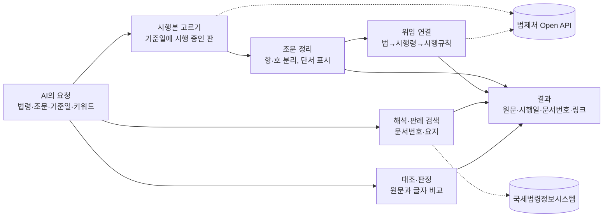

# korean-tax-mcp — Korea Tax Law MCP (한국 세법)

<!-- mcp-name: io.github.UpstageAI/korean-tax-mcp -->


[](https://pypi.org/project/korean-tax-mcp/) [](https://registry.modelcontextprotocol.io/v0/servers?search=korean-tax-mcp) [](LICENSE) [](https://www.upstage.ai/) · [English](README-EN.md)

> **0.7.0부터 Solar Pro 4가 코드를 쓰고** CodeSolar가 리뷰, Claude가 테스트로 교차 검증합니다. 도구 23개, 상세는 [CHANGELOG](CHANGELOG.md).

**Korea tax law for AI agents** — statutes as in force on any date, NTS rulings and court decisions, basic rules, treaties. [English](README-EN.md)

---

> 세법 쟁점을 AI에 물으면, 그 시점의 조문과 국세청 해석·판례를 문서번호와 함께 가져옵니다.

## 작동 방식



1. **조문** — 법제처에서 기준일에 시행 중이던 판을 골라 원문을 주고, 단서 구절과 위임 조문(법→시행령→시행규칙)을 함께 붙입니다. 기준일을 안 주면 오늘 기준입니다.
2. **해석·판례** — 국세법령정보시스템에서 질의회신·판례·심판례·통칙·집행기준을 문서번호·링크로 찾습니다.
3. **그 해 기준** — 세목별 기준일(사업연도 말일, 양도일 등)의 조문·해석을 모으고 현행과 바뀐 점을 표시합니다.
4. **대조** — 진술·보기를 원문과 글자 단위로 비교해 다른 숫자·단서를 표시합니다.

판단과 결론은 사용자의 AI와 전문가 몫입니다. 이 서버는 근거를 가져옵니다.

## 이렇게 물어보세요

- "2023년 12월 31일 기준 법인세법 시행규칙 제43조 원문"
- "법인세법 제52조를 인용한 최근 질의회신·판례 보여줘"
- "2019 사업연도 기준으로 법인세법 제52조 관련 조문·통칙·해석 정리해줘"
- "'경조금은 건당 10만원까지 증빙 없이 손금'이라는 말, 2026 시행령 제41조 원문과 맞아?"
- "미국 시민권자 대표이사, 작년 국내 체류 200일, 가족은 미국 — 거주자야?"

## 설치

```bash
claude mcp add korean-tax -- uvx korean-tax-mcp
```

```json
{
  "mcpServers": {
    "korean-tax": {
      "command": "uvx",
      "args": ["korean-tax-mcp"],
      "env": { "LAW_OC": "법제처 OC(선택)", "UPSTAGE_API_KEY": "Upstage 키(선택)" }
    }
  }
}
```

| 키 | 쓰는 곳 |
|---|---|
| 없음 | 해석·판례·통칙·집행기준·사례집·조약·서식·책자 검색, 승패 비교, 거주자 판정 |
| `LAW_OC` ([open.law.go.kr](https://open.law.go.kr) 무료) | 조문 조회·찾기·개정 이력, 그 해 기준 묶음, 진술·보기 대조, 인용 검증(조문) |
| `UPSTAGE_API_KEY` (선택) | 사실관계 대조·승패 요약·영문 번역을 Solar가 수행. 없으면 사용자 AI가 수행 |
| `KOREAN_TAX_MCP_SOLAR_BASE_URL` (선택) | 망분리 환경에서 기관 내부 Solar 사용 |

> **데이터 전송 안내** — 기본 동작은 법제처·국세청 공개 API만 호출하며, AI 판단·요약·번역(사실관계 대조, 승패 요약, 영문 번역)은 사용자 AI가 수행합니다. Upstage로 전송되는 내용은 없습니다. 선택: `UPSTAGE_API_KEY`를 설정하면 Solar가 대조·요약·번역을 수행하며, 이때 입력 내용이 Upstage API(api.upstage.ai)로 전송되니 **개인정보 등 민감정보는 넣지 마세요**. 망분리 환경에서는 `KOREAN_TAX_MCP_SOLAR_BASE_URL`로 기관 내부 Solar에 연결하면 외부 전송 없이 사용할 수 있습니다.

## 도구 (23개)

| 묶음 | 도구 | 하는 일 |
|---|---|---|
| 조문 | `law_article` | 기준일 시행본 원문, 목차, 위임 조문, 단서 구절 |
| | `find_article` | 조문 번호를 모를 때 키워드로 찾기 |
| | `article_history` | 언제 바뀌었는지, 시행 예정 개정 |
| 해석·판례 | `search_tax_rulings` | 질의회신·판례·심판례 검색 |
| | `get_tax_ruling` | 문서 본문 전문 |
| | `rulings_by_article` | 특정 조문을 인용한 해석·판례 |
| | `basic_rules` | 국세 기본통칙 전문 |
| | `execution_standards` | 세법집행기준 항목·쪽·링크 |
| | `casebook_search` | 2025 세법해석 사례집(96건) |
| 그 해 기준·검증 | `research_issue` | 세목별 기준일의 조문·통칙·해석 묶음, 현행 대비 변경 |
| | `timing_rules` | 시기 규칙표 — 납세의무 성립·손익 귀속·소득별 수입시기·부가 공급시기 |
| | `verify_citations` | 초안 속 문서번호·조문이 실제로 있는지 |
| 대조·판정 | `verify_statement` | 한 문장을 원문과 글자 대조 |
| | `judge_options` | 보기 여러 개를 조문과 한 번에 대조 |
| | `compare_outcomes` | 같은 쟁점의 납세자 승·패 결정 나란히 |
| | `compare_with_case` | 우리 사실관계와 해석·판례 비교(지지·반대·구별) |
| 조약·거주자 | `tax_treaty` | 조세조약 96개국 조문(국·영문) |
| | `treaty_withholding_rates` | 배당·이자·사용료 제한세율 |
| | `residency_check` | 거주자·비거주자 3단계 판정(규칙) |
| | `residency_report` | 판정 검토 보고서(Solar) |
| 문서·서식 | `search_forms` | 별표·서식 |
| | `search_nts_publications` | 국세청 발간책자 본문 |
| | `search_local_documents` | 내 PC PDF 검색(`KOREAN_TAX_MCP_DOCS`) |

모든 도구는 `lang="en"`으로 영어 결과를 받을 수 있습니다.

## 면책

이 도구의 결과는 **세무 자문이 아닙니다**. 세법 근거를 찾아 보여 주는 참고 자료이며, 실제 신고·세무조사·불복 판단은 세무사·회계사·변호사 등 전문가에게 확인하세요. 해석·판례·조문은 원문 링크로 확인하세요.

이 도구는 **세무사법 제2조의 세무대리**(세무조정계산서 작성, 신고·불복 대리, 세무상담 등)를 수행하지 않으며, 그 업무는 세무사와 등록한 공인회계사·변호사만 할 수 있습니다(세무사법 제20조). 공개된 법령·해석·결정례 원문을 찾아 보여 주는 소프트웨어이고, 데모 화면의 "조사 쟁점 근거 조회" 같은 사례도 자료 조회·정리 기능의 시연일 뿐 사실관계 판단이나 대응 전략 제시가 아닙니다. 사실관계 판단과 대응은 세무 전문가(세무사·회계사·변호사)와 함께 확인해 주세요.

## AI 사용 고지

- **조회·검색·거주자 규칙 판정**(`search_tax_rulings`, `get_tax_ruling`, `law_article`, `residency_check` 등)은 코드로 동작합니다 — 생성형 AI가 개입하지 않습니다.
- **생성형 AI가 작성하는 결과**: 사실관계 대조(`compare_with_case`), 승패 요약(`compare_outcomes` `explain=True`), 영문 번역(`lang="en"`), 거주자 판정 보고서(`residency_report`)는 생성형 AI(기본: 사용자 AI, 선택: Upstage Solar Pro 4)가 작성합니다.
- Solar가 작성한 결과(`mode: "solar_cloud"` 또는 `"solar_onprem"`)에는 결과에 `AI 생성 표시` 필드가 함께 반환됩니다. 이 표시의 문구는 AI 기본법 제31조에 따른 것입니다.
- 사용자 AI(`mode: "host_ai"`)가 판단하는 경우는 결과에 AI 생성 표시가 붙지 않으며, 대신 안내 문구에 "판단 결과를 사용자에게 보여 줄 때 AI 생성임을 표시하세요"가 포함됩니다. 실제 표시는 사용자 측 AI 도구에서 수행하세요.

## 유의

- 해석·판례는 회신·선고 당시 법 기준입니다. 적용 연도 조문(`law_article`의 `as_of`)과 대조하세요.
- 국세법령정보시스템 공개 조회를 1일 캐시, 0.5초 간격으로 사용합니다. 집행기준은 항목·쪽·링크까지만 제공합니다.
- 일반 법령 전반은 [korean-law-mcp](https://github.com/chrisryugj/korean-law-mcp)와 함께 쓰면 좋습니다.

## 평가 방법

Solar Pro 4가 이 MCP 서버들을 도구로 써서 세법 객관식 문항을 푸는 종합 평가는 `eval/` 폴더를 참고한다. 도구 하나하나의 정확도는 `bench/`에서 측정한다.

## 출처 · 라이선스

국세청 국세법령정보시스템 · 법제처 국가법령정보 공동활용 · 국세청 「2025 세법해석 사례집」

MIT © 2026 Upstage · Created by Mia(윤승미)
